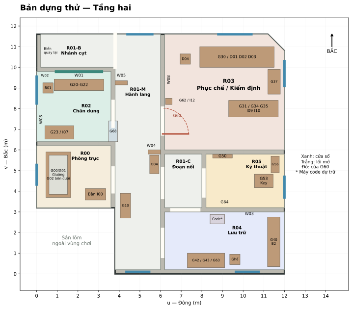
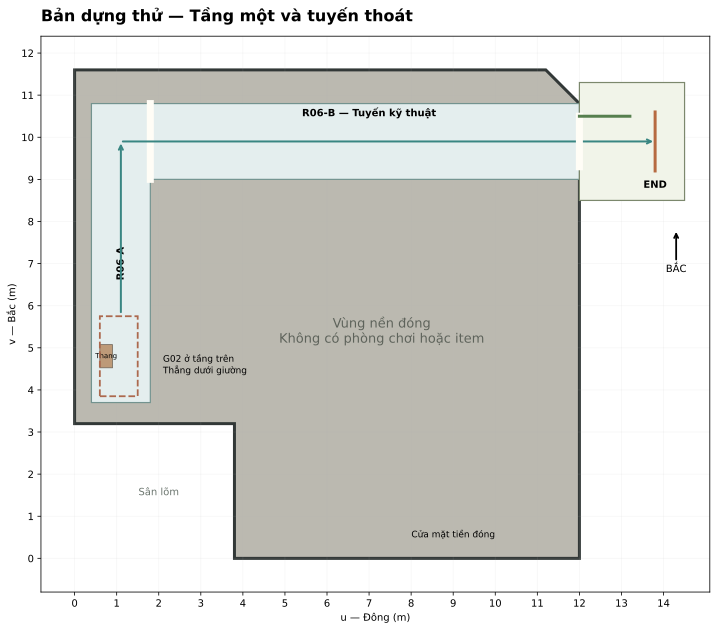

# Bản phác thảo ngôi nhà bảo tàng và toàn bộ vật thể

Bản dựng thử 1 ngày 12 tháng 10 năm 2026. Tài liệu này là đầu vào cho AI dựng một bản chơi cơ bản: có ngôi nhà, các phòng, mọi vật thể, thông tin để xem, balo và đường đi đến kết thúc. Mỗi block có đầu ra và điều kiện hoàn thành riêng. Hoàn thành block hiện tại rồi mới làm block tiếp theo.

Kích thước và tọa độ dưới đây là lựa chọn cho bản thử, có thể điều chỉnh sau khi chạy thử. Nội dung bằng chứng, mã item và các điều kiện của flow phiên bản 3 giữ nguyên. File này cụ thể hóa vị trí của `03_kien_truc.md`; `01_flow.md` quy định truyện, `02_clues.md` quy định nội dung nguồn, `05_events.md` quy định sự kiện ở giai đoạn sau. Phần nội dung nguồn cần cho bản dựng được chép đầy đủ vào Block 13 để có thể giao riêng file này cho AI.

Trong giai đoạn này dùng shape, màu phẳng và chữ rõ. Chỉ cần một chế độ chiếu sáng xem bản dựng đồng đều, không tối ưu mỹ thuật hay dựng cảnh hù. Âm thanh, ánh sáng kinh dị và việc tìm asset là đợt làm việc sau. Các vị trí phục vụ sự kiện được dự trữ ngay từ kiến trúc.

## Block 00 Hợp đồng của bản dựng thử

Người chơi tỉnh trong R00 ở tầng hai. Đọc tờ I00 trên bàn, đi vào bảo tàng, xem ảnh và vật thể, hoàn thành hồ sơ, lấy O05 rồi quay về mở giường. Lối xuống dẫn tới R06 ở tầng một và ra ngoài. Có đúng một kết thúc. Một phòng R03 đóng khóa một lần; các gian khác không tự nhốt người chơi.

R00 chỉ có giường, bàn, tờ I00, phần vỏ phòng và đèn người chơi đã giữ. Các cửa sổ, mép sàn và bộ phận của giường là kiến trúc, không thêm giấy, ảnh, ghế hoặc đồ nhặt mới vào phòng này. Không có NPC đòi đồ, chết khi giải sai, truy đuổi hoặc tủ phải bê đi.

Mọi vật thể có tên được đặt trong vùng chơi đều có hành động Xem. Đồ trang trí có mô tả ngắn, cũng xem được, nhưng không sinh nguồn bắt buộc. Vật thể có cơ cấu có thêm hành động riêng như Mở ngăn, Xoay hoặc Dùng dấu. Các bộ phận nhỏ như vít, chân bàn, thanh khung và tấm kính dùng cùng mục Xem của vật thể mẹ; không tạo hàng trăm mục balo cho chúng. Sàn, trần, tường nguyên khối không được tính là item; các chi tiết có tên gắn trên tường được tính và được mô tả riêng.

Không tự thêm đồ vật hoặc manh mối ngoài danh sách. Cần thêm một đồ có thể nhấn thì bổ sung ID, vị trí, shape, mô tả Xem, loại lưu và tác động tiến trình trước. Trong bản thử không có một shape mang mã item nhưng để trống nội dung quyết định.

Đầu ra: một scene có thể đi từ đầu tới cuối bằng placeholder, không chỉ một mô hình để chụp hình.

## Block 01 Phong cách và hình dáng toàn nhà

Ngôi nhà là một biệt thự cũ hai tầng đã được cải tạo thành bảo tàng nhỏ. Thân nhà có mặt bằng chữ L, góc đông bắc được vát nhẹ. Mái là hai cụm mái dốc nối theo hai cánh chữ L, màu đỏ đất. Mặt tường kem cũ, chân tường xanh xám; khung cửa gỗ nâu, các tranh và hiện vật mang xanh ngọc, xanh lam, vàng men và đỏ gạch. Nhà có màu dù đã bỏ hoang. Không phủ một màu xám lên toàn bộ vật thể.

Khối phía tây chứa phòng trực và gian chân dung. Cánh phía đông chứa gian phục chế, kho hồ sơ và gian kỹ thuật. Hành lang chạy giữa hai cánh, có hai đoạn vách ngắn làm lệch tầm nhìn và một nhánh cụt ở phía bắc. Khoảng lõm phía tây nam là sân nhỏ ngoài nhà, không thuộc khu khám phá. Không có nhà thứ hai, sân rộng để đi lang thang hoặc thêm tầng ba.

Mặt bằng ngoài rộng tối đa 12 m theo đông tây, 11,6 m theo nam bắc. Diện tích phủ bì tầng hai khoảng 126,72 m² trước khi trừ tường. Đây là bản thử được nới từ mốc tham chiếu 70 m² ban đầu để có đủ chỗ cho nhiều gian, đọc đồ và mở cơ cấu. Tổng các vùng bố trí phòng và đoạn hành lang khoảng 117 m²; diện tích đi được thực tế nhỏ hơn sau khi tính tường ngoài và đồ. Không lấy diện tích hoặc quãng đi vòng để bảo đảm thời lượng game.

Mỗi gian có một điểm nhận ra: R00 giường; R01 tủ thấp và kệ Camera; R02 khung xanh ngọc; R03 ba hiện vật trên cùng một bàn; R04 dãy ngăn 3×3; R05 hộp ba hồ sơ; R06 thang kỹ thuật và tuyến thoát. Màu sắc hỗ trợ phân biệt, tên gian vẫn ghi bằng chữ.

Placeholder vật liệu: tường kem `#D8C9AE`, chân tường xanh xám `#607C78`, sàn gỗ `#80664F`, đá nền `#90948E`, kim loại `#8C9397`, giấy `#EEE5CD`, xanh ngọc `#3B887C`, xanh lam `#447AA1`, đỏ gạch `#AA5D49`, vàng men `#C5A34B`. Tất cả bề mặt tạm dùng màu phẳng. Nét cũ được làm bằng vài plane nhỏ có tên, không rải đồ vụn ngẫu nhiên.

Đầu ra: nhìn toàn nhà nhận ra biệt thự hai tầng chữ L; mỗi gian có ngôn ngữ màu và một điểm nhận biết riêng.

## Block 02 Mặt bằng tọa độ và đường nối

### Hệ tọa độ

Tọa độ được viết `(u, v, h)` tính bằng mét. `u` tăng về đông, `v` tăng về bắc, `h` là độ cao trên mặt sàn của tầng đang chứa vật. Tầng một có sàn ở cao độ 0; tầng hai có sàn ở cao độ 3,6 m. Nếu dựng trong Godot, ánh xạ `X = u`, `Y = cao độ tầng + h`, `Z = -v`. Tọa độ vị trí của đồ nội thất là tâm đáy; tọa độ bảng/ảnh gắn tường là tâm mặt xem. Đồ nằm trong ngăn dùng tọa độ con riêng ở bảng chứa đồ.

Phía bắc trong sơ đồ luôn là hướng `v` tăng. Không xoay bản đồ hoặc đổi trái phải theo mỗi phòng. Kích thước ghi `u × v × h`; một vật dài dọc v thì giá trị v lớn hơn. Đồ đặt trên mặt bàn có h bằng cao mặt bàn, không đặt tâm vật chìm một nửa vào bàn.

Vỏ ngoài theo polygon: `(3,8;0) → (12;0) → (12;10,8) → (11,2;11,6) → (0;11,6) → (0;3,2) → (3,8;3,2)`. Các đoạn nối này đóng vòng. Không tạo sàn ở vùng sân lõm ngoài polygon.

### Phòng và vùng chức năng

Các khoảng dưới là vùng tham chiếu để dựng sàn và đặt đồ. Với mặt giáp tường ngoài, trừ thêm 0,2 m vào trong cho tường; vùng đi lại bắt đầu sau mặt trong này. Khe 0,2 m giữa hai phòng dành cho một bức tường chung. Không dựng hai bức tường trùng nhau trong khe đó. Cao thông thủy tầng hai 3,2 m; tầng một 3,2 m. R01 gồm các vùng liên thông, không phải bốn phòng riêng.

| Mã | Tên hiển thị | Tầng | Giới hạn u | Giới hạn v | Vai trò |
| --- | --- | --- | --- | --- | --- |
| R00 | Phòng trực | 2 | 0 đến 3,6 | 3,2 đến 6,2 | Xuất phát, giường che lối xuống |
| R01-M | Hành lang | 2 | 3,8 đến 6,0 | 0,2 đến 11,6 | Trục nối các gian |
| R01-B | Nhánh niêm phong | 2 | 0,2 đến 3,8 | 10,0 đến 11,6 | Nhánh cụt tùy chọn, nối mở với đầu bắc R01-M |
| R01-C | Đoạn nối kho và kỹ thuật | 2 | 6,2 đến 8,0 | 3,2 đến 5,8 | Đi trực tiếp giữa R04 và R05 |
| R02 | Gian chân dung | 2 | 0 đến 3,6 | 6,4 đến 9,8 | Tranh, ba đĩa, F02 |
| R03 | Gian phục chế và kiểm định | 2 | 6,2 đến 12 | 6,0 đến 11,6 | P03 và câu đố cửa E08; vát góc đông bắc 0,8 m |
| R04 | Gian lưu trữ | 2 | 6,2 đến 12 | 0,2 đến 3,0 | Dãy ngăn, bàn đọc, máy ghi âm |
| R05 | Gian kỹ thuật | 2 | 8,2 đến 12 | 3,2 đến 5,8 | Bảng kỹ thuật, hộp chìa khóa |
| R06-A | Chân thang kỹ thuật | 1 | 0,4 đến 1,8 | 3,7 đến 10,8 | Nhận người chơi sau khi xuống dưới giường |
| R06-B | Tuyến ra ngoài | 1 | 1,8 đến 12,0 | 9,0 đến 10,8 | Nối mở với R06-A, ra cửa phía đông |
| EXT-END | Hiên thoát | 1 | 12,0 đến 14,5 | 8,5 đến 11,3 | Vùng ngắn ở ngoài nhà dẫn tới ranh giới kết thúc |

R03 dùng polygon thông thủy `(6,2;6,0), (12;6,0), (12;10,8), (11,2;11,6), (6,2;11,6)`. R06-A và R06-B là cùng một gian hình L: hợp nhất mặt sàn ở chỗ giao, không có tường chắn tại u = 1,8. Các khối tầng một còn lại nằm trong vỏ nhà và ngoài R06; chúng là vùng nền đóng, không có item, cửa gameplay hoặc một lối thoát thứ hai. Không xây thêm một bộ phòng có tên hay vật phẩm dưới tầng một.

### Cửa và lối mở

| ID portal | Hai bên | Tâm u,v | Bề rộng × cao | Loại và trạng thái | Vùng cần để trống |
| --- | --- | --- | --- | --- | --- |
| PORT-00 / G04 | R00 ↔ R01-M | 3,7;4,55 | 1,15 × 2,15 | Lối mở có khung, không cánh | Hai phía rộng 1 m, không ngưỡng cao |
| PORT-02 | R02 ↔ R01-M | 3,7;7,75 | 1,20 × 2,15 | Lối mở không cánh | Khoảng trước cửa tới v = 8,35 |
| PORT-03 / G60 | R03 ↔ R01-M | 6,1;7,40 | 1,25 × 2,15 | Một cánh bản lề, đầu lượt mở, E08 khóa một lần | u 6,1 đến 7,45; v 6,65 đến 8,1 |
| PORT-04 | R04 ↔ R01-M | 6,1;1,50 | 1,30 × 2,15 | Lối mở không cánh | u 6,2 đến 7,2 |
| PORT-C | R01-M ↔ R01-C | 6,1;4,40 | 1,40 × 2,15 | Lối mở không cánh | Không đặt đồ trong đoạn nối |
| PORT-04C | R04 ↔ R01-C | 7,20;3,10 | 1,30 × 2,15 | Lối mở không cánh | u 6,55 đến 7,85 ở hai phía |
| PORT-05 | R05 ↔ R01-C | 8,10;4,40 | 1,25 × 2,15 | Lối mở không cánh | u 8,2 đến 9,2; v 3,75 đến 5,05 |
| PORT-B | R01-M ↔ R01-B | 3,80;10,80 | 1,60 × 3,20 | Giao hành lang, không khung cửa | Toàn góc rẽ, không đồ chắn |
| PORT-06 / G02 | R00 ↓ R06-A | 1,05;4,80 | Lỗ 0,90 × 1,90 | Lỗ sàn bị giường che; chỉ đi xuống sau Open | Không có sàn đặc trùng vị trí lỗ |
| PORT-EXIT | R06-B → EXT-END | 12,0;9,90 | 1,20 × 2,15 | Cửa ngoài đã mở cố định | Mặt sàn liên tục, không bậc vấp |
| ENV-ENTRANCE | Mặt tiền tầng một | 9,00;0 | 1,50 × 2,30 | Cửa kiến trúc đóng, vùng nền không chơi | Không đặt trigger mở hoặc lối đi tới cửa |

Các phòng phải thông nhau bằng lỗ thật trong mesh và collider. Không chỉ dán một hình cửa lên tường đặc. R01-C là đường nối đã mở từ đầu, không có thêm khóa. Khung G60 giữ phần khóa bên trong; không tạo một cửa tự khóa nữa cho PORT-04C.

### Vách bẻ và vùng đi lại

R01-M có hai vách ngắn cố định: `ENV-R01-SCREEN-S` ở u 5,4 đến 6,0, v 5,8 đến 6,0; `ENV-R01-SCREEN-N` ở u 3,8 đến 4,4, v 9,15 đến 9,35. Chúng cao 3,2 m, cùng vật liệu tường. Mỗi vách để ít nhất 1,6 m bề rộng thông qua. Không đặt vách trong lỗ cửa phòng. W04 gắn mặt nam vách S; W05 gắn mặt nam vách N. Hai mặt này nhìn thấy khi đi từ phía nam lên.

Lối chính rộng tối thiểu 1,2 m sau khi tính đồ; vùng chuyển hướng cần một khoảng đường kính 1,2 m. Khe hẹp cuối R06-A rộng 1,4 m. Nhánh cụt có khoảng quay ở u 0,3 đến 1,5; v 10,1 đến 11,5. Vách và hốc không thay đổi vị trí sau event.

Điểm đứng xem là vùng trống, không phải item: R00 trước bàn `(2,35;4,1)`; R02 trước cơ cấu `(2,05;8,1)`; R03 trước bàn hiện vật `(9,7;9,15)` và trước bàn kiểm tra `(10,3;6,8)`; R04 trước dãy ngăn `(10,1;1,55)`; R05 trước hộp `(11,0;3,55)`. Không đặt ghế hoặc đạo cụ vào các vùng này.

Đầu ra: đi qua đủ các gian, đường về luôn tồn tại, các cửa dùng cùng vị trí ở cả hai phòng.

## Block 03 Vỏ nhà cửa sổ và ngoại cảnh

### Vỏ kiến trúc

Mỗi vùng phòng có floor, ceiling và các đoạn tường theo mặt bằng. Tường ngoài nằm trong polygon vỏ, dày 0,2 m theo phía vào nhà; tường chung nằm đúng khe 0,2 m giữa các vùng phòng. Không áp một wall vào chính giữa phòng chỉ vì tâm đoạn tường chưa xác định. Sàn và wall ngoài phải giao kín; sàn giữa tầng dày 0,2 m, mặt trên ở h tầng hai = 0. Sàn tầng hai phải khoét PORT-06 ngay khi dựng, sau đó dùng collider của giường/nắp để chặn từ đầu. Trần R06-A cũng phải có lỗ tương ứng, không để player xuống vào một khối sàn đặc. Mặt dưới mái ở cao độ 6,8 m, đỉnh mái khoảng 8,4 m. Mái không phải tầng đi được.

Chân tường mỗi gian cao 0,85 m, là màu hoặc strip mỏng. Nẹp gỗ sát sàn cao 0,10 m, dày tối đa 0,015 m; nằm sát tường, không tạo bậc cho collider. Khung portal dày 0,06 m, sâu 0,10 m. Độ cao lỗ cửa 2,15 m. Sàn không có mảnh gạch nhô, đống đá hoặc dây làm người chơi kẹt.

Gạch/tấm gỗ chỉ là pattern không có mã. Trần có dầm giả sát trần, không hạ xuống vùng đầu người. Không có đèn điện đang hoạt động trong nhà; đèn bàn hỏng ở R04 là prop. Không đặt bóng đèn phát sáng mới để giải thích một cửa sổ hoặc đồ bị lộ. Bản dựng tạm xem bằng chiếu sáng đồng đều của chế độ kiểm tra.

Toàn bộ tường được định danh theo phòng và hướng, ví dụ `ENV_R02_W_N`. Tường chung có một chủ sở hữu trong nhóm Shell; mục mô tả hai phòng chỉ tham chiếu nó. Bốn góc sân ngoài và mái phải khép; chế độ editor có thể ẩn mái/trần, bản đi lại phải bật lại.

### Danh sách cửa sổ tầng hai

Tất cả cửa sổ đều cố định, không mở, không dùng làm lối ra. Bề rộng ở bảng là chiều ngang dọc tường. Hốc kính G68 nằm giữa phòng và hành lang, không phải cửa sổ ngoài trời. Mỗi cửa sổ có khung box, kính plane, bậu nhỏ, collider của khung và kính, cùng nút Xem. Kính không có vật phẩm phía sau để nhặt xuyên.

| ID | Gian và tường | Tâm u,v,h | Ngang × cao | Nội dung nhìn ra ngoài | Xem |
| --- | --- | --- | --- | --- | --- |
| ENV-WIN-00 | R00 tây | 0;4,8;2,25 | 0,95 × 0,65 | Tán cây gần, tường rào cũ xa, trời nhiều mây; không có chìa khóa/biển chỉ giường | Ô cửa đã chốt cố định |
| G13-A | R01-M nam | 4,9;0,1;2,25 | 1,10 × 0,65 | Phần mái hiên thấp và tán cây phía sân lõm; không có người ngoài sân | Ô sáng cao của hành lang |
| G13-B | R01-M bắc | 5,0;11,6;2,25 | 1,20 × 0,65 | Trời và ngọn cây phía bắc; dành hướng nhìn lên ở E06 sau này | Kính cao nhìn về vườn phía bắc |
| ENV-WIN-02 | R02 tây | 0;8,9;2,30 | 1,30 × 0,65 | Cùng hàng cây của cửa R00, crop cao hơn; góc khung có khe nhỏ để chim vào | Khung cũ có một khe hở ở cao |
| ENV-WIN-03E | R03 đông | 12;9,7;2,30 | 1,20 × 0,65 | Mái kho phụ ở xa và ngọn cây; kho chỉ là cảnh nền không có đường gameplay | Ô kính cố định phía gian phục chế |
| ENV-WIN-03N | R03 bắc | 9,6;11,6;2,45 | 1,60 × 0,45 | Trời nhiều mây và cành cây phía bắc, cùng cảnh nền G13-B | Dải kính cao sát trần |
| ENV-WIN-04 | R04 nam | 10,2;0,1;2,25 | 1,10 × 0,65 | Mái hiên mặt tiền, một phần cổng xa mờ; không có cửa sổ nhìn sang phòng khác | Ô kính trên dãy lưu trữ |
| ENV-WIN-05 | R05 đông | 12;4,2;2,25 | 1,00 × 0,65 | Cành cây và mái phụ phía đông, cùng cảnh nền ENV-WIN-03E | Ô kính của gian kỹ thuật |

Ba cửa sổ trang trí tầng một trên mặt ngoài: `ENV-WIN-1W` tại `(0;7,5;1,8)`, ngang 1,0 × cao 1,0; `ENV-WIN-1S` tại `(10,4;0;1,8)`, 1,0 × 1,0; `ENV-WIN-1E` tại `(12;4,5;1,8)`, 1,0 × 1,0. Chúng bị chớp gỗ/ô kính mờ đóng cố định, chỉ thuộc vỏ nhà không có nội thất nhìn xuyên. Không cần để người chơi tương tác từ bên trong vùng nền đóng.

### Ngoại cảnh bằng ảnh hoặc plane

Bản thử chưa cần cây, cổng hay nhà kho 3D. Tạo bốn cảnh nền có tên `BG-WEST`, `BG-NORTH`, `BG-EAST`, `BG-SOUTH`, dùng các plane màu có chữ mô tả khung cảnh. Bản asset sau thay bằng ảnh cho cùng hướng, không dùng ảnh khác nhau khiến một cửa nhìn thấy hai khu vườn mâu thuẫn. Ảnh cùng hướng phải dùng chung panorama, chỉ crop khác nhau.

Plane ở ngoài tường tối thiểu 3 m, không đặt sát kính như một tấm poster. Đặt phía có hình hướng vào nhà, không tự xoay theo camera. Có lớp tiền cảnh bằng 2 đến 3 shape đơn giản ở ngoài xa: tán cây dạng đĩa, dải mái thấp, strip tường rào. Chúng có mã thuộc cảnh nền, không collider, không tương tác, không balo. Ngoại cảnh không chứa biểu tượng câu đố hoặc chữ khiến người chơi phải đọc.

`BG-WEST` tại u = -6, trải v 3 đến 12; `BG-NORTH` tại v = 17, trải u -2 đến 13; `BG-EAST` tại u = 19, trải v -1 đến 13; `BG-SOUTH` tại v = -6, trải u -1 đến 13. Chiều cao các card đủ che từ cao độ 0 đến 10 m. Ảnh nền phía đông cũng được nhìn thấy từ EXT-END; tránh đặt một ảnh ở cao độ tầng hai rồi để phần dưới trống khi xuống tầng một.

EXT-END có sàn 2,5 × 2,8 m, hai dải rào thấp sát cạnh bắc/nam làm giới hạn nhìn thấy được, không có lỗ đi ra vùng vô hạn. Phông cây phía trước xa và một mảng nền trời. Ranh giới kết thúc ở u = 13,8, v 9,2 đến 10,6; người chơi đi qua để kết thúc trước mép sàn u = 14,5. Không đặt đồ nhặt hoặc một cánh cổng khóa ở đây.

Đầu ra: tám cửa sổ tầng hai đều có khung cảnh đúng hướng, không nhìn xuyên vào chân không hoặc tạo một lối thoát phụ.

## Block 04 R00 Phòng trực và bí mật dưới giường

### Tường sàn và trần

Tường bắc v = 6,2 là tường chung với R02, chỉ có màu kem và chân tường, không tranh. Tường đông u = 3,6 có PORT-00 ở v = 4,55; hai đoạn tường còn lại trống. Tường nam v = 3,2 nhìn ra sân lõm nhưng không có cửa ra ngoài hoặc giấy giấu. Tường tây có ENV-WIN-00; dưới ô là giường. Sàn gỗ phẳng, ngoại trừ khe mỏng quanh phần bị giường che. Trần kín, một dầm phẳng sát trần theo đông tây; không treo đồ.

### Vật thể

| ID | Shape và kích thước | Vị trí u,v,h | Hướng/mối quan hệ | Hành động Xem và hành động khác |
| --- | --- | --- | --- | --- |
| G00 | Khung bệ bằng bốn box, phủ bì 1,20 × 2,20 × 0,38 | 1,05;4,80;0 | Đầu giường hướng bắc, chân hướng nam; lòng bệ rỗng, thân đứng yên | Giường có khóa cơ khí ở cạnh. Tham chiếu G01 để mở |
| G01 | Tấm cánh box 1,20 × 2,20 × 0,10 | 1,05;4,80;0,38 | Trục bản lề dọc cạnh tây u = 0,45; nâng cánh vào phía tây | Trước O05: Locked. Có O05: Open. Không nhấc G00 |
| G02 | Lỗ sàn và khung nắp 0,90 × 1,90 | 1,05;4,80;0 | Thẳng trên R06-A, có khung bệ nhìn thấy sau khi mở | Trước mở không có mục Đi xuống; sau mở có Đi xuống |
| G03 | Bàn box mặt 1,00 × 0,55, cao 0,75; bốn chân cùng root | 2,85;3,85;0 | Dài theo u, đứng cách tường; không có ngăn | Bàn cũ chỉ có một tờ hướng dẫn |
| I00 | Giấy plane 0,15 × 0,21 | 2,85;3,85;0,756 | Nằm trên bàn, đầu trang về phía bắc | Xem trước/sau; đóng lần đọc đầu tự cất |
| G04 | Khung PORT-00 | 3,70;4,55;0 | Không có cánh cửa | Lối dẫn ra hành lang |
| PLAYER-TORCH | Cylinder dài 0,18, đường kính 0,04 | Gắn camera người chơi | Có sẵn từ khi bắt đầu, không là một vật phẩm nhặt | Xem trong mục Trang bị; không nhặt pin |

Nệm, tấm vải và gối nếu thể hiện bằng shape thì là các mảng con của G01, đi theo cánh. Không là đồ nhặt, không có giấy dưới gối. Khóa và bản lề là phần con của G00/G01, cùng thông tin Xem. Trong bản thử có thể chỉ dùng tấm cánh trơn để tránh cắt xuyên.

Điểm bắt đầu `(2,15;4,60)` trên sàn tầng hai; mắt cao 1,6 m, nhìn về bàn `(2,85;3,85;0,75)`. Không bắt đầu bên trên giường hoặc hướng thẳng vào lối sàn. Người chơi xoay lại nhìn thấy giường và lối PORT-00.

Khi Open, cánh G01 quay 85 độ; kiểm vùng u 0,45 đến 1,65, v 3,7 đến 5,9. Nếu người chơi đứng trong vùng, yêu cầu lùi về điểm `(2,15;4,60)`, không đẩy họ bằng collider. Mép bệ giữ một viền cao nhìn thấy được để không vô tình đi rơi xuống. Không cho nhảy trong bản thử. Chọn Đi xuống mới chuyển người chơi sang chân thang.

G02 không có một chiếc nắp đóng thứ hai phải giải nữa: miệng lối được bệ và cánh giường che. Bản thử dùng thang kim loại cố định và chuyển vị trí có kiểm soát tới R06, không ép một cầu thang đầy đủ vào lỗ dài 1,9 m. Dưới lỗ phải thực sự trống; phần thang được mô tả ở Block 10.

G00 không dùng một box đặc bao toàn bộ bệ: bốn thanh để rỗng đúng lỗ 0,90 × 1,90 ở giữa. Hai thanh dài tâm u = 0,51 và 1,59, kích thước 0,12 × 2,20 × 0,38; hai thanh ngang tâm v = 3,775 và 5,825, kích thước 0,96 × 0,15 × 0,38. Chúng dùng chung ID G00. G01 là mặt che duy nhất nằm trên khung. Khi đã Open không giữ collider hoặc plane đặc vô hình trong lòng bệ.

Nếu soi thấy khe sớm, Xem chỉ ghi “Một cơ cấu khóa nằm dưới bệ giường.” Không bật Open, không cộng KEY_OWNED, không hiện đáp án tầng. I00 vẫn chỉ kết thúc bằng hình chìa khóa và “nó ở đâu...”.

Đầu ra: đúng một tờ giấy; có thể đọc, cất, đi ra; giường không mở trước O05 và mở được sau O05.

## Block 05 R01 Hành lang nhánh cụt và Camera

### Bố trí các bề mặt

Phần nam của R01-M có G13-A ở cao, dưới là tường kín. Tường tây lần lượt có tủ G10 gần v = 3,3; lối R00; vết ố N02; hốc kính G68; lối R02. Vách N nằm trước góc rẽ nhánh, mang W05. Tường đông có lối R04, kệ Camera, lối đoạn nối, vách S mang W04, cửa R03. Phần bắc có G13-B. Trần hành lang có ống phẳng sát trần, không thấp ngang mặt người.

R01-B chạy từ góc rẽ sang tây, có tường nam chung với R02 và tường bắc ngoài nhà. Cuối tây là tường kín với biển quay lại, không có hình cửa hoặc vết nứt có thể chui qua. R01-C không có đồ đặt sàn, chỉ biển gian, một đoạn ống phục vụ E09 và các lối đã ghi. Nhãn biển đặt cạnh/ở trên portal, không nằm giữa bề rộng đi.

### Vật thể và nguồn

| ID | Shape và kích thước | Vị trí u,v,h | Bố trí | Xem và tương tác |
| --- | --- | --- | --- | --- |
| G10 | Tủ thấp box 0,50 × 1,20 × 0,75 | 4,30;3,30;0 | Sát tường tây; mặt ngăn hướng đông | Tủ lưu ảnh có một ngăn kéo |
| G11 | Một ngăn rộng 1,00 theo v, sâu 0,42, cao 0,20 | Con G10 ở h = 0,45 | Trượt về đông 0,35; tay nắm rõ | Xem, Mở/Đóng; không khóa |
| F01 | Plane ảnh 0,24 × 0,16 | Trong G11, ô trái | Cách I01 một khoảng 0,04 | Xem, Nhặt; ảnh vào balo |
| I01 | Plane giấy 0,15 × 0,21 | Trong G11, ô phải | Nằm cạnh ảnh, không chồng lên ảnh | Xem, Nhặt |
| G12 | Kệ box 0,45 × 0,90 × 0,08 | 5,70;5,30;0,95 | Tường đông; không đối ngang tủ G10 | Kệ chỉ có máy ảnh |
| O04 | Box 0,12 × 0,08 × 0,075, cylinder ống kính, dây phẳng | 5,70;5,30;1,036 | Trên kệ, ống kính hướng tây | Xem, Nhặt; bật chức năng Camera |
| G13-A/B | Hai ô kính cao theo Block 03 | Theo bảng cửa sổ | Hai phần cùng nhóm G13 | Xem ô kính, không mở |
| G66 | Cylinder đồng hồ đường kính 0,35, dày 0,05 | 5,98;2,10;2,10 | Mặt hướng tây; bảng dưới h = 1,55 | Đồng hồ hỏng, không dùng làm giờ; nhãn đúng ĐỒNG HỒ HỎNG |
| G68 | Hốc kín rộng 1,00 theo v, sâu 0,45, cao 2,20 | 3,70;6,90;0,25 | Kính mặt đông u = 3,92, lưng opaque u = 3,47, có nền ở h = 0,25 | Hốc trưng bày có kính cố định; không lấy đồ bên trong |
| W04 | Plane ảnh trong khung 0,50 × 0,80 | 5,68;5,79;1,55 | Mặt nam vách S, hướng nam | Xem, lưu nguồn bổ sung; không nhặt |
| W05 | Plane giấy 0,45 × 0,64 | 4,10;9,14;1,55 | Mặt nam vách N; hai đinh là phần con | Xem, lưu nguồn bổ sung; không nhặt |
| ENV-BACK-SIGN | Bảng box mỏng 0,95 × 0,50 | 0,21;10,80;1,55 | Mặt hướng đông ở cuối nhánh | KHU VỰC NIÊM PHONG — QUAY LẠI |
| N02 | Plane vết ố 0,50 × 0,75 | 3,81;5,60;1,30 | Trên đoạn tường thật phía bắc lối R00 | Vết nước cũ chạy xuống tường; không chữ, không nguồn |

Biển gian gồm đúng bốn bảng chính và một bảng chỉ nhánh: `ENV-SIGN-02` cạnh PORT-02 ghi “CHÂN DUNG”; `ENV-SIGN-03` cạnh G60 ghi “PHỤC CHẾ / KIỂM ĐỊNH”; `ENV-SIGN-04` cạnh PORT-04 ghi “LƯU TRỮ”; `ENV-SIGN-05` cạnh PORT-C ghi “KỸ THUẬT →”; `ENV-SIGN-B` ở góc R01-M/R01-B ghi “KHU NIÊM PHONG”. Tâm biển chính đặt trên portal ở h = 2,45, ngoại trừ bảng KỸ THUẬT ở `(5,97;4,40;1,65)` cạnh lối. Nhãn đọc được khi đi lại, không in các mã R.

Ống trần gồm ba đoạn liên thông: dọc R01-M tại u = 5,8, h = 2,85; bẻ vào R01-C ở v = 4,8; nối về R05. Chúng là `ENV-PIPE-01A/B/C`, cylinder đường kính 0,10; không bịt portal. Xem: “Ống kỹ thuật đi qua các gian.” Chưa phát âm. Một điểm tương lai E09 tại `(5,98;3,8;0,8)` là marker trong editor, không item hoặc chữ hiện trong game.

G68 là một recess: bỏ phần tường trong đúng thể tích hốc, dựng lưng đặc ở u = 3,47 và hai cạnh kín, không giữ một wall đặc chạy qua giữa hốc. Lưng bít sang R02 nên không thành lối đi hoặc ô nhìn xuyên phòng. Phần ăn vào mép R02 tối đa u 3,47 đến 3,6, đã tránh bàn phụ. B05 được dự trữ tại `(3,70;6,90;0,25)`, capsule cao 1,55 m, bán kính 0,16 m, không collider đi lại. Mặc định ẩn trong bản dựng; dùng công tắc debug để thử hốc. Không có một người đứng ngoài cửa sổ tầng hai.

Dàn cảnh nhánh có ba marker ẩn: bắt đầu cảnh báo `(2,9;10,8)`, an toàn cuối nhánh `(0,8;10,8)`, hồi phục `(4,9;9,7)`. Đi tới biển luôn được quay về; không đóng đường. B03/B04 là proxy hình người và gậy ở `(3,15;10,8)` để thử chỗ khuất, mặc định ẩn. Khi triển khai E06 sau này, G13-B ở đầu bắc trục chính là ô kính trong góc nhìn khi quay về phía đông.

G14 không nằm sẵn trong R01: vị trí gốc ở kệ R03. Điểm dành cho B06 ở ngoài G60 là `(5,75;7,4;0)`, chỉ proxy đổ bóng không collider; mặc định ẩn. Không đặt một khối chặn người chơi tại đó.

Shape của B03 là capsule cao 1,65 m, bán kính 0,22, tâm đáy `(3,15;10,8;0)`, hướng tây; B04 là cylinder dài 0,70, đường kính 0,04, gắn bên tay phải ở h = 1,10 và nghiêng 30 độ. B06 là box 0,20 × 0,50 × 0,20 tại điểm đã ghi. Đây là transform test trong editor; khi làm cảnh E06 phải điều chỉnh pose theo điểm người chơi đang đứng, không bật capsule cắt vào người. Cả ba mặc định ẩn và không có collider đi lại.

Đầu ra: lấy được F01, I01 và O04; nhánh quay về bình thường; Camera không bắt buộc; không đi xuyên hốc kính.

## Block 06 R02 Gian chân dung

### Tường sàn và trần

Tường bắc v = 9,8 có W01, W02 và cơ cấu phía dưới; phía bên kia là nhánh R01-B, không đặt cửa sổ ngoài trời trên tường này. Tường đông u = 3,6 có PORT-02; góc đông nam có lưng hốc G68 đặc, không lối mở. Tường nam v = 6,4 có bàn phụ G23. Tường tây có W06, N01 và ENV-WIN-02 ở cao gần tượng. Sàn gỗ cùng R00 nhưng màu nâu đỏ hơn; trần kín, không đồ treo thấp.

### Vật thể và nguồn

| ID | Shape và kích thước | Vị trí u,v,h | Hướng và tổ chức | Xem và hành động |
| --- | --- | --- | --- | --- |
| W01 | Plane tranh 2,20 × 1,45, khung box dày 0,05 | 2,05;9,79;1,65 | Mặt hướng nam; khung xanh ngọc, sứt góc dưới phải | Xem toàn hình/ba tay; tự lưu W01 |
| W02 | Plane bảng 0,65 × 0,55, hai thanh kẹp | 0,40;9,79;1,15 | Cạnh trái W01, không nằm trong khung tranh | Xem chữ; tự lưu W02 |
| G20 | Bệ box 2,40 × 0,55 × 0,80; ba đĩa cylinder đường kính 0,18 | 2,05;9,15;0 | Đĩa trái/giữa/phải ở u 1,35 / 2,05 / 2,75, mặt hướng nam | Xem cơ cấu, xoay từng đĩa qua LÁ/CHÉN/CHUÔNG |
| G21 | Tay gạt cylinder dài 0,12 | 3,05;8,86;0,85 | Cạnh phải bộ đĩa | Xem, Gạt để kiểm P02 |
| G22 | Ngăn box rộng 0,90, sâu 0,40, cao 0,18 | Con G20 tại u 2,05, h 0,45 | Mặt nam, trượt về nam 0,30 | Xem khóa; mở sau P02; không tự cất F02 |
| F02 | Plane ảnh 0,24 × 0,18 | Trong G22, chính giữa | Không có item khác | Xem, Nhặt |
| G23 | Bàn box 1,40 × 0,65 × 0,75, một ngăn phụ | 1,10;6,85;0 | Mặt ngăn hướng bắc, trượt về bắc 0,25 | Xem bàn; mở ngăn không khóa |
| I07 | Plane giấy 0,15 × 0,21 | Ngăn G23 | Giấy duy nhất trong ngăn | Xem, Nhặt; tùy chọn |
| G65 | Cylinder bút dài 0,16, đường kính 0,01 | 1,40;7,05;0,756 | Trên bàn G23; có vị trí trước/sau lăn cùng mặt bàn | Một bút chì, không có chữ hoặc mật mã; không nhặt |
| W06 | Plane tranh 1,00 × 0,90, khung mỏng | 0,205;7,30;1,50 | Mặt hướng đông, mảng màu; tên Nắng trong sân | Xem; không nguồn bắt buộc, không nhặt |
| N01 | Ba strip bút chì dài 0,10/0,15/0,12 | 0,206;7,30;2,10 | Phía trên W06, cùng một root | Các nét đo khi treo tranh; không tạo ba hình học |
| B01 | Bệ box 0,50 × 0,50 × 0,70 và bust capsule cao 0,55 | 0,55;9,00;0 | Hốc trang trí tường tây, hướng đông | Tượng bán thân trang trí; Xem, không xoay, không clue đáy |
| B02 | Proxy chim sphere thân, cone mỏ, hai plane cánh; cao 0,22 | Trên đỉnh B01 ở h = 1,25 | Mặc định ẩn; vị trí thử E04 | Nếu bật thử: Xem con chim; không item, không nguồn |

Hốc tượng dùng một khung nông rộng 0,70 theo v, cao 1,6; bệ đứng trong phòng, không có lỗ đi xuyên tường. Khe ở góc trên ENV-WIN-02 rộng khoảng 0,08 m, nằm trên tầm người chơi và chỉ là chi tiết giúp chim có nguồn. Không làm collider cho player chui lọt.

W01 trong bản shape vẫn phải cho thấy đủ ba người và các đồ cầm hiện tại: mẹ CHÉN, cha CHUÔNG, trẻ LÁ. Có thể dùng ba silhouette hình học và biểu tượng đơn giản ở tay. F01 thể hiện mẹ LÁ, cha CHÉN, trẻ CHUÔNG. Vết sứt khung phải nằm cùng góc khi đối chiếu. Không dùng hai plane chỉ ghi “ảnh sẽ bổ sung” vì sẽ không giải được câu đố.

G20, G21 và G22 là cơ cấu riêng, không con của khung W01. Khung rung sau này không làm ngăn hoặc collider dịch theo. Sai tổ hợp giữ lựa chọn, không khóa lại lối phòng. Ba đĩa có số nấc như nhau; ghép đúng LÁ/CHÉN/CHUÔNG và đủ nguồn P02 thì ngăn mở.

Đầu ra: xem và so F01/W01/W02, điều khiển ba đĩa, mở ngăn lấy F02; mọi prop của gian có mục Xem.

## Block 07 R03 Gian phục chế và phòng niêm phong duy nhất

### Tường sàn và trần

Tường tây u = 6,2 có G60 ở phía nam, W08 ở phía bắc. W07 nằm trên mặt trong cánh cửa, không trên một tường khác. Tường bắc v = 11,6 có ô kính ENV-WIN-03N ở cao; bên dưới là bàn ba hiện vật. Tường đông có kệ G37, ô ENV-WIN-03E phía trên, không cửa ra ngoài. Tường nam v = 6,0 trống để đứng trước bàn kiểm tra. Mảng vát đông bắc dài khoảng 1,13 m chỉ có màu tường, không giấu nguồn. Sàn đá xanh xám phẳng; trần có hai dầm giả sát h = 3,0, không hạ xuống mặt bàn.

Lối đi phía tây u = 6,5 đến 8,0 là vùng vào và tiếp cận cửa; không đặt bàn ở đó. Bàn hiện vật ở phía bắc, bàn kiểm tra ở phía nam đông, kệ ở phía đông giữa. Bốn vật không xếp thành một hàng gồm bốn món: bộ ba trên G30, mặt nạ ở bệ riêng phía tây bắc.

### Vật thể và nguồn

| ID | Shape và kích thước | Vị trí u,v,h | Tổ chức | Xem và hành động |
| --- | --- | --- | --- | --- |
| G30 | Bàn box 3,60 × 1,00 × 0,85 | 9,70;10,50;0 | Mặt bàn hướng xem từ nam, không có ngăn | Bàn trưng bộ ba hiện vật |
| PX-R03-BASE-01/02/03 | Ba cylinder đế đường kính 0,35, cao 0,15 | u 8,50 / 9,70 / 10,90; v 10,50; h 0,85 | Con G30, độc lập với vòng số cửa | Xem: Bệ xoay cố định; không nhặt |
| D01 | Cylinder chén đường kính 0,22, cao 0,18, vành cylinder mỏng | 8,50;10,50;1,00 | Trên đế trái; xanh lam/kem | Xem, xoay/nghiêng, trả góc; đáy tam giác/R08, tem trăng |
| D02 | Box lá dẹt 0,22 × 0,38 × 0,025, cuống cylinder | 9,70;10,50;1,00 | Trên đế giữa; xanh đồng | Xem, xoay/nghiêng; mặt dưới tròn/R17, tem sóng |
| D03 | Cone chuông đường kính 0,20, cao 0,24, vòng tay cầm | 10,90;10,50;1,00 | Trên đế phải; vàng đồng | Xem, xoay/nghiêng; vành đáy vuông/R23, tem cây |
| PX-R03-BASE-04 | Bệ box 0,50 × 0,50 × 0,90 | 7,20;10,40;0 | Bệ riêng, không nối P03 | Bệ của mặt nạ đối chứng |
| D04 | Box mặt nạ 0,25 × 0,10 × 0,35, lỗ mắt giả | 7,20;10,40;0,90 | Mặt hướng nam, sau có tem | Xem, xoay; tem sao/B31; không là hiện vật thứ tư của P05 |
| G31 | Bàn kiểm tra box 2,40 × 0,80 × 0,80 | 10,50;8,00;0 | Mặt thao tác hướng nam | Bàn có cơ cấu ba đĩa và ngăn hồ sơ |
| G32 | Ba đĩa cylinder đường kính 0,16 | u 10,35 / 10,75 / 11,15; v 7,70; h 0,83 | Phía trước bàn, icon tam giác/tròn/vuông | Xem, xoay từng đĩa; kiểm P03 |
| G33 | Tay gạt dài 0,12 | 11,45;7,70;0,83 | Cạnh phải ba đĩa | Xem, Gạt |
| G34 | Ngăn rộng 1,25, sâu 0,60, cao 0,18 | Con G31 tại u 10,95, h 0,45 | Hướng nam, trượt 0,35; khóa P03 | Xem, mở khi đúng P03; chứa I02/O01 |
| I02/O01 | Plane phiếu / dấu box+cylinder | Hai ô trong G34 | Giấy bên trái, dấu bên phải | Xem, nhặt riêng từng món |
| G35 | Ngăn phụ rộng 0,85, sâu 0,60, cao 0,18 | Con G31 tại u 9,80, h 0,45 | Hướng nam, trượt 0,35; không khóa | Xem, Mở/Đóng; không phụ thuộc P03 |
| I06/F08/I08 | Hai plane giấy và một bảng sáu ảnh | Ba vị trí trong G35 | I06 phía trái sau, I08 trái trước, F08 bên phải | Xem, nhặt từng món; F08 vẫn là một item |
| I09 | Plane giấy 0,18 × 0,25 | 9,80;7,83;0,806 | Trên bàn, cách đĩa và giấy I10 | Xem, Nhặt; phiếu lệch giờ |
| I10 | Plane giấy 0,18 × 0,25 | 10,55;8,13;0,806 | Trên bàn, kẹp ở cạnh; không bị đồ khác phủ | Xem, Nhặt; biên bản đã sửa |
| G36 | Chốt cylinder đường kính 0,035, dài 0,06 | 9,70;10,02;0,76 | Mép bàn hiện vật, chỉ đổi góc nhỏ sau P05 | Xem: Chốt của đế hiện vật; không item |
| G37 | Kệ box 0,60 × 1,20 × 1,70, ba tầng và một ngăn mở | 11,50;9,30;0 | Mặt hướng tây, không chạm G30/G31 | Xem kệ; ngăn thấp mở sẵn |
| F07 | Plane ảnh 0,24 × 0,16 | Trên tầng giữa G37 ở v 9,65, h 1,05 | Ảnh rời nằm ngửa; vùng đứng xem ở phía tây | Xem, Nhặt; ảnh năm 2012 |
| I11 | Plane giấy 0,15 × 0,21 | Ngăn thấp mở sẵn G37 ở v 8,95, h 0,45 | Không khóa, không nằm dưới hộp hoặc lon | Xem, Nhặt; nhật ký báo động |
| G14 | Cylinder lon đường kính 0,08, cao 0,14 | 11,35;9,45;1,58 | Trên kệ; trạng thái sau tại 11,10;9,45;0 | Một lon rỗng; Xem, không nhặt, không collider cản đường |
| G69 | Box sắt dẹt 0,18 × 0,12 × 0,035 | 11,35;8,95;1,58 | Trên kệ; trạng thái sau tại 11,10;8,90;0 | Một hộp dụng cụ rỗng; Xem, không nhặt |
| G60 | Cánh box rộng 1,25, cao 2,15, dày 0,04 | Theo PORT-03 | Bản lề ở phía nam v = 6,775, mở vào R03 hướng đông | Xem cửa, thử tay nắm, mở lại sau giải E08 |
| G61 | Bốn vòng số cylinder và tay gạt | Mặt trong G60, tâm h = 1,10 | Con cánh, bốn vòng 0–9 từ trái sang phải; gạt bên phải | Xem, đổi số, Gạt; đáp án 3581 |
| W07 | Plane bảng men 0,65 × 0,45 | Mặt trong G60, h = 1,70 | Đi cùng cánh; mặt xem về trong phòng khi đóng | Xem toàn quy trình; tự ghi sổ |
| G62 | Khay box 0,32 × 0,30 × 0,06 | 6,40;8,35;0,75 | Gắn phần khung cố định phía bắc cửa, trượt về đông 0,30 | Xem khay; mở sau 3581 |
| I12 | Plane giấy 0,15 × 0,21 | Trong G62 | Chỉ tiếp cận sau khi khay mở | Xem, Nhặt; nguồn thứ 19 của hồ sơ chính |
| W08 | Plane bảng 1,05 × 0,85, khung gỗ mỏng | 6,215;9,40;1,65 | Tường tây, mặt hướng đông, không kính | Xem bảng đổi dấu; tự ghi sổ |

Ba dụng cụ trang trí trên G31: `PX-R03-CLOTH` là box khăn gấp 0,20 × 0,15 × 0,02 tại `(11,45;8,25;0,806)`; `PX-R03-PEN` là cylinder bút dài 0,14 tại `(10,95;8,30;0,806)`; `PX-R03-CLIP` là kẹp chữ U kích thước 0,03 trên cạnh I10. Xem tương ứng: “Khăn phục chế đã cũ.”, “Bút dùng ghi biên bản.”, “Kẹp giữ tờ biên bản.” Không in số, hình học hoặc ký hiệu mới. Kẹp thuộc root giấy I10 và biến khỏi thế giới khi nhặt I10, không treo lơ lửng sau đó.

Trong chế độ Xem D, dùng bản xem 3D cô lập để xoay vật đầy đủ mà không cần nhấc khỏi bệ. Bản trong phòng giữ vị trí cố định; lưu góc trưng bày riêng nếu làm xoay tại chỗ. Bản xem phải có mặt dưới, không chỉ một hình mặt trước. D01–D03 ghi nhận hình học và mã cùng mặt; tem kiểm định là chi tiết riêng. D04 ghi tem sao và B31. Không dùng một ảnh đáy dựng sai với shape.

### Cửa và dữ liệu luôn tiếp cận được

G60 mở đầu ở góc 90 độ, nằm trong vùng quét đã dành trống. Trigger vào sâu là box u 7,50 đến 8,00, v 7,05 đến 7,75, h 0 đến 2,0. Trước đóng kiểm thân người chơi đã qua cửa, không đứng trong vùng quét, không đang Xem. Cửa quay về góc 0 rồi chốt khóa. Chỉ collider cánh thực tế chặn lối.

G61/W07 ở mặt trong cánh; người bị nhốt luôn tương tác được. Nhập 3581 rồi Gạt mở khóa ngay, dù chưa nhặt hoặc xem đủ các nguồn địa phương. Hủy các nhịp hù đang chờ; mở G62. Người chơi tự mở cánh và tự nhặt I12. Sau `DOOR_SOLVED`, cửa không tự khóa lại và khay giữ mở nếu giấy chưa lấy.

E08 có chín nhóm nguồn: F07; D01/D02/D03/D04; I08; F08; I09; I10; W07; I11; W08. Không nhóm nào nằm trong G34, không cần F02 ngoài phòng, không cần O04. G14/G69 chỉ là đạo cụ, không giữ hoặc sinh I11. Đi vào R03 ngay sau khi tỉnh dậy vẫn phải giải được cửa bằng mọi nguồn có sẵn trong R03.

Bản dựng thử cần chức năng cửa một lần và các cơ cấu; các tiếng gõ, vật rơi, bóng dưới khe chưa chạy. Tạo hai pose cho G14/G69 và các marker, mặc định giữ pose trên kệ. Không cần bật vật lý rơi để nghiệm thu kiến trúc.

Đầu ra: hai câu đố độc lập cùng ở một gian; vào sớm không mắc kẹt; mọi mặt dưới đọc được; lấy đủ I12, I02 và O01 theo điều kiện đúng.

## Block 08 R04 Gian lưu trữ và bàn đọc

### Tường sàn và trần

Tường đông là dãy ngăn G40, tất cả nhãn nhìn từ phía tây. Tường bắc v = 3,0 có PORT-04C ở phía tây và W03 phía đông. Tường tây có PORT-04 ở v = 1,5. Tường nam có cửa sổ cao ENV-WIN-04, bàn G42 ở phía tây. Sàn gỗ tối hơn R02, trần kín. Không có một cửa ngoài trời hoặc cửa sổ có thể trèo ra.

### Vật thể và nguồn

| ID | Shape và kích thước | Vị trí u,v,h | Bố trí | Xem và hành động |
| --- | --- | --- | --- | --- |
| G40 | Tủ ngăn box 0,60 × 2,40 × 1,75 | 11,48;1,55;0 | Mặt hướng tây; hàng A trên, B giữa, C dưới | Xem dãy ngăn; chọn từng ngăn riêng |
| G40-A1/A2/A3/B1/B3/C1/C2/C3 | Tám ngăn thường, mỗi ngăn ngang 0,72, sâu 0,45, cao 0,32 | Theo ma trận bên dưới | Trượt về tây 0,20; không chứa bằng chứng | Xem, mở nông; nội dung là giấy kê |
| G41 = G40-B2 | Một ngăn hồ sơ cùng kích thước | 11,48;1,55;0,95 | Không tạo ngăn B2 thứ hai; trượt tây 0,35, khớp O01 | Xem, dùng dấu Hiện vật để mở đúng ngăn |
| I03/F03/O02 | Hai plane tài liệu và một dấu | Ba ô riêng trong G41 | I03 trái, F03 giữa, O02 phải khi đứng nhìn vào ngăn | Xem, Nhặt từng món; không chồng |
| W03 | Plane bảng 1,00 × 0,95, khung nhôm | 10,30;2,985;1,50 | Mặt hướng nam, nhìn được trước khi thử ngăn | Xem; lưu ma trận và quy tắc |
| G42 | Bàn box 1,80 × 0,70 × 0,75 | 8,20;0,65;0 | Sát nam nhưng không chạm tường, mặt thao tác hướng bắc | Bàn đọc hồ sơ, có ngăn phụ |
| G43 | Ngăn rộng 1,20, sâu 0,50, cao 0,18 | Con G42 ở h = 0,45 | Mặt bắc, trượt bắc 0,30; không khóa | Xem, mở/đóng; chứa F05/I05 |
| F05/I05 | Plane ảnh / giấy | Hai ô trong G43 | Ảnh trái, giấy phải | Xem, Nhặt; tùy chọn |
| G63 | Máy ghi âm box 0,50 × 0,30 × 0,25, hai cylinder cuộn | 8,75;0,65;0,756 | Mặt nút hướng bắc; nhãn nguồn tự duy trì | Xem thông tin máy; Play/Stop dự trữ cho đợt âm thanh |
| G67 | Plane giấy trắng 0,15 × 0,21 | 7,95;0,75;0,756 | Trên bàn, khác I05 đã nằm trong ngăn | Tờ giấy kê trắng, không chữ; Xem, không nhặt |
| PX-R04-LAMP | Cylinder chân và cone chụp; cao 0,40 | 7,45;0,55;0,756 | Trên bàn, không đè giấy | Đèn bàn hỏng; Xem, không bật nguồn sáng |
| PX-R04-CHAIR | Ghế box mặt 0,50 × 0,50 và lưng cao 0,85 | 9,60;0,70;0 | Bên đông bàn; không ở phía ngăn kéo, không chắn lối | Chiếc ghế trống; Xem, không đẩy hoặc ngồi |
| PX-R04-FILLER-01 đến 08 | Tám bó giấy box 0,25 × 0,18 × 0,015 | Một bó trong mỗi ngăn thường | Nhãn tên theo ngăn, không một số khác ngoài nhãn ngăn | Giấy kê của hồ sơ khác, không thuộc bộ đang tra; Xem, không nhặt |

Ma trận dãy ngăn: khi đứng phía tây nhìn về đông, cột 1 ở bên trái là phía bắc v = 2,30; cột 2 v = 1,55; cột 3 v = 0,80. Hàng A có tâm mặt ngăn h = 1,40; B h = 0,95; C h = 0,50. Mỗi ngăn có nhãn và tay nắm cùng root. Không quay ma trận W03 ngược với ngăn thật. Nội dung tám ngăn thường phải thống nhất, không phát một mẩu giấy ngẫu nhiên có vẻ giống nguồn chính.

G41 vẫn có thể dùng O01 sau khi đã mở để xem thông tin, không mất dấu. Nếu lấy thiếu một trong ba món, ngăn giữ mở và sổ nêu tên món còn trong ngăn. B2 có đủ chỗ cho ba item rời; không đặt O02 dưới F03 rồi yêu cầu kéo ảnh đi.

G63 trong bản kiến trúc có bản chép sẵn khi Xem máy: “Phiếu nhận lại đã bị sửa. Đừng chỉ tin nhãn trên thùng. Tôi để bản lưu trong khay kiểm định. Nếu ra được khỏi đây, mang giấy theo. Linh.” Chưa phát giọng hoặc tạo giọng ở ghế. Bản âm thanh sau sẽ cho Play/Stop và E11 theo file events. Dòng chép này là thông tin bổ sung, không cộng nguồn thứ 20.

Góc bàn đọc là chỗ để mở balo và đối chiếu. Không thực thi sự kiện lúc đang đọc. Điểm âm tương lai E11 nằm phía sau ghế `(9,6;0,4;1,1)`; là marker ẩn, không đặt một người ở đó trong bản dựng.

Đầu ra: ngăn thật đúng ma trận; dùng dấu mở B2; lấy ba món riêng; xem được bàn, ghế, máy, giấy trắng và tám bó giấy phụ.

## Block 09 R05 Gian kỹ thuật và hộp chìa khóa

### Tường sàn và trần

Tường tây có PORT-05 mở từ đầu. Tường bắc có G50, đoạn ống và N03, không treo bản sao đầy đủ F04 bên ngoài bảng. Tường đông có ENV-WIN-05 và ngăn G56 thấp hơn ô kính. Tường nam có G64 thấp gần sàn. Sàn đá xám, trần kín. Không có giếng để rơi qua, một cửa xuống khác hoặc đồ lăn cạnh hộp khi lấy key.

### Vật thể và nguồn

| ID | Shape và kích thước | Vị trí u,v,h | Tổ chức | Xem và hành động |
| --- | --- | --- | --- | --- |
| G50 | Bảng/hốc kỹ thuật box rộng 0,95, cao 1,15, sâu 0,18 | 9,00;5,79;1,45 | Tường bắc, mặt hướng nam; hốc nằm trước tường đặc | Bảng kỹ thuật có khóa dấu đường đi |
| G51 | Chốt cylinder đường kính 0,07 | 9,35;5,58;1,30 | Mặt trước, cùng biểu tượng O02 | Xem, dùng O02; không tiêu hao dấu |
| G52 | Cánh box 0,95 × 0,04 × 1,15 | Con G50 | Bản lề cạnh tây u = 8,525, v = 5,60, mở vào phía nam | Xem, mở khi đã dùng dấu |
| F04/I04/O03 | Plane sơ đồ / giấy / dấu | Trong hốc G50 | Sơ đồ trái trên, giấy phải trên, dấu dưới | Xem, Nhặt từng món sau khi cánh mở |
| PX-R05-PLINTH | Bệ box 0,90 × 0,65 × 0,70 | 11,00;4,50;0 | Bệ cố định, không di chuyển | Bệ của hộp kiểm kê |
| G53 | Hộp box 0,75 × 0,50 × 0,42 | 11,00;4,50;0,70 | Mặt tương tác hướng nam, đặt trên bệ | Xem ba hồ sơ và tình trạng thiếu nguồn |
| G54 | Ba hàng kết luận và ba điểm áp dấu | Mặt nam G53 | HIỆN VẬT, ĐƯỜNG ĐI, TẦNG theo chiều từ trên xuống | Chọn kết luận, chọn dấu phù hợp; xác nhận từng hàng |
| G55 | Nắp box 0,75 × 0,50 × 0,04 | Con G53 ở h = 1,12 | Bản lề cạnh bắc v = 4,75, quay lên 90 độ | Xem; mở khi ba hàng hợp lệ |
| O05 | Chìa box thân, cylinder vòng, ba răng | Trong G53 ở h = 0,75 | Tạo từ đầu, bị nắp che/collider chặn | Xem, Nhặt sau khi nắp mở; bật KEY_OWNED |
| G56 | Tủ nhỏ/ngăn box 0,40 × 0,80 × 0,70 | 11,55;5,30;0 | Mặt hướng tây, trượt tây 0,30, không khóa | Xem, mở; chứa F06 |
| F06 | Plane ảnh dọc 0,15 × 0,21 | Trong G56 | Không món nào khác | Xem, Nhặt; tùy chọn |
| G64 | Lưới box 0,60 × 0,03 × 0,35 | 9,10;3,205;0,30 | Mặt hướng bắc, khe thấp có ống hướng xuống | Xem: Khe của tuyến thông gió; không mở/đi xuyên |
| N03 | Plane nhãn 0,45 × 0,18 | 10,45;5,78;2,40 | Trên ống bắc, mũi tên nhỏ hướng xuống | V2 — THÔNG GIÓ; không là mã tầng |
| ENV-PIPE-05 | Cylinder ống đường kính 0,12 | Theo bắc ở h = 2,75 rồi xuống G64 | Ba đoạn gắn tường, không chắn bảng | Ống thông gió kỹ thuật; Xem |

G50 có lưng ở v = 5,79, mặt cánh đóng ở v = 5,60; các nguồn ở trong khoảng này. Vùng mở u 8,525 đến 9,475, v 4,60 đến 5,80. Nếu người chơi trong vùng này, hoãn mở và yêu cầu lùi về v ≤ 4,2. Vị trí đứng dùng chốt `(9,0;4,2)` đủ xa để cánh không cắt người. Không mở cánh ra phía sau xuyên tường bắc.

G53 có câu hỏi rõ trong chế độ Xem: “Hiện vật đang trưng bày là gì?” → Bản gốc/Bản sao; “Đồ bàn giao đi qua đâu sau xưởng?” → Trưng bày/Kho phục chế/Phòng trực; “Phòng trực ở tầng nào?” → Tầng một/Tầng hai/Tầng ba. Kết luận đúng BẢN SAO / KHO PHỤC CHẾ / TẦNG HAI. O01/O02/O03 áp lên hàng tương ứng, vẫn trong balo.

Tạo chữ trên mặt hộp để thấy ba hàng, nhưng các lựa chọn dài dùng UI xem cơ cấu, không ép chữ nhỏ vào shape. Đủ 19 nguồn của Block 12 và ba hàng đúng thì mở G55. O05 vẫn cần người chơi nhặt. Quên key thì sổ nêu key còn trong hộp, không đổi mục tiêu sang quay về.

Đầu ra: O02 mở hốc, lấy đủ ba món, đủ bằng chứng mới mở hộp và nhặt đúng chiếc chìa khóa giống I00.

## Block 10 Tầng một tuyến thoát và các bí mật kiến trúc

R06 dùng hai đoạn hình L theo Block 02. Vỏ tầng một vẫn có đủ tường/mái hiên để nhìn ngoài thấy nhà hai tầng; những phần ngoài R06 không mở thành phòng chơi. Không đặt item trong vùng nền đóng. Người chơi không tới tầng một từ một cầu thang trong hành lang tầng hai.

Thang `ENV-LADDER-06` nằm ở đầu R06-A, ngay dưới G02: hai cylinder thanh dọc cách nhau 0,55 m và 15 thanh ngang, cách khoảng 0,24 m; phần trên kết nối hốc sàn ở cao độ 3,6 m. Trục thang tại u = 0,75, v = 4,8; chiều cao khoảng 3,5 m. Hố thang có tường bao và miệng dưới nhìn thấy, không kết thúc vào một floor đặc. Bản thử chọn Đi xuống và chuyển có kiểm soát tới điểm `(1,05;5,8;0)` trên sàn R06-A; không cần animation người leo. Tắt điều khiển trong chuyển ngắn, rồi trả lại. Không cho đi ngược lên sau ranh giới kết thúc.

Tường tây R06-A là tường ngoài, tường đông là tường nền đóng. Tường bắc mở vào R06-B. R06-B có tường nam nền đóng và tường bắc ngoài nhà; phía đông là PORT-EXIT. Không treo ảnh, giấy hoặc một bảng mã mới. Trần có vài dải ống đơn giản cùng root, không vật rơi. Nền bê tông phẳng, không nước có collider hoặc bậc trượt.

| ID | Shape | Vị trí | Xem và chức năng |
| --- | --- | --- | --- |
| ENV-LADDER-06 | Hai thanh và 15 bậc cylinder | Dưới G02 theo mô tả | Thang kỹ thuật dưới phòng trực; Đi xuống ở đầu trên khi mở |
| ENV-PIPE-06A | Cylinder ống dọc, đường kính 0,12 | Tường đông R06-A, u 1,78, v 6 đến 9,8, h 2,6 | Ống của tuyến kỹ thuật, không clue |
| ENV-PIPE-06B | Cylinder ống ngang, đường kính 0,12 | Dọc tường nam R06-B, v 9,02, u 2 đến 11,5, h 2,6 | Ống đi về phía ngoài, không clue |
| ENV-EXIT-DOOR | Cánh box 1,20 × 0,04 × 2,15 và khung | PORT-EXIT, hinge phía bắc v = 10,5 | Cửa ngoài đã mở, không có khóa mới; Xem |
| ENV-EXIT-FENCE-N/S | Hai dải box h = 0,9 | Mép bắc/nam EXT-END | Rào thấp ở hiên; Xem nếu trong tầm, không mở |

Mặt sàn R06-B ra EXT-END cùng cao độ; cánh cửa ngoài mở 90 độ vào phía hiên sát rào bắc, không nằm giữa đường. Một trigger ở u = 13,8 ghi END_REACHED và hiện kết thúc. Không chạy lại nhánh hù hoặc giấu một tờ giấy cuối ở hiên.

Danh sách bí mật đầy đủ của nhà: giường G01 che G02; ngăn G22 dưới tranh; ngăn G34 của bàn phục chế; cửa G60 và khay G62; hồ sơ B2; hốc G50 sau cánh; key trong G53. Hốc G68 là đạo cụ sự kiện, không cửa bí mật. W06, vết ố, khe kính, kho phụ trong cảnh nền, các vùng đóng tầng một không có khoang giải đố. Không có một lối vào bí mật qua cửa sổ hoặc mái.

Đầu ra: xuống được qua vị trí thực dưới giường, tới tuyến tầng một không xuyên collider, ra ngoài và kết thúc không cần vật phẩm mới.

## Block 11 Tương tác Xem và các cơ cấu

### Điều khiển cơ bản

Dùng góc nhìn thứ nhất với thân va chạm cao khoảng 1,75 m, bề rộng khoảng 0,6 m, mắt cao 1,6 m. Bản thử có đi, nhìn, tương tác, balo và Camera; không nhảy, không kéo thả đồ ngoài thế giới. Tâm ngắm nhỏ. Tầm chọn đề xuất 1,8 m từ mắt, phải kiểm collider vật chắn; không lấy giấy xuyên mặt bàn, kính hoặc cửa đóng.

Nhìn vào một root hợp lệ hiện tên và hành động “Xem”. Nhấn tương tác mở chế độ xem. Đồ nhặt có nút Nhặt riêng; nguồn tường có tự ghi sổ; cơ cấu có nút thao tác. Có thể hỗ trợ thao tác nhanh cho tay nắm/nút nhấn nhưng vẫn giữ mục Xem ở cùng đối tượng. Một item không vừa tự nhặt vừa bật một scene hù trong cùng lần bấm.

Đồ trang trí như ghế, bút, lon, giấy kê, cửa sổ chỉ cho một mô tả cụ thể đã viết trong các block phòng. Không hiện “có lẽ chứa bí mật” cho mọi prop. Không tạo thẻ hồ sơ chưa giải cho những đồ này. Khi đồ trang trí quá nhỏ để chọn riêng như kẹp, chỉ chọn root mẹ và liệt kê trong mô tả.

### Các loại xem

| Loại | Giao diện | Lưu | Hành động khác |
| --- | --- | --- | --- |
| F ảnh rời | Mặt trước/sau, phóng to, phần hình/chữ đúng Block 13 | Item khi Nhặt | Nhặt; so với nguồn khác |
| I giấy | Mặt/trang trước/sau, bản chép chữ tiếng Việt, zoom | Item khi Nhặt; I00 ngoại lệ tự cất lần đầu | Nhặt, chuyển trang |
| W nguồn cố định | Toàn ảnh/bảng, zoom, bản chép chữ nếu có | Thẻ quan sát, không mất vật ở tường | So; không Nhặt |
| D vật cố định | Bản xem shape 3D có đủ mặt, xoay/nghiêng, về góc gốc | Quan sát vùng đáy/tem | Xoay; không Nhặt |
| O vật sử dụng | Bản xem xoay được, tên/nhãn/công dụng đã biết | Item trong balo | Nhặt hoặc chọn Dùng tại cơ cấu hợp lệ |
| G/PX/ENV prop và cơ cấu | Tên + mô tả; có thể xem hình/shape | Chỉ lưu trạng thái cơ cấu, không thẻ balo | Mở, đóng, nhấn, gạt nếu định nghĩa |
| B actor proxy | Xem tên khi không trong cảnh khóa điều khiển | Không item, không nguồn | Chỉ dành test vị trí, mặc định ẩn |

Không xoay toàn bộ phòng khi Xem tranh. Cửa sổ/hốc vẫn có mô tả nếu chưa có ảnh nền. Khi đóng chế độ Xem, trả góc đi lại và điều khiển cũ, không làm người chơi xuất hiện bên trong vật. Ngừng nhận input đi lại khi UI đang mở. Nếu đang nhặt nhiều item trong một ngăn, không tự đóng ngăn sau món đầu.

### Khoảng trống và chứa đồ

Kích thước tủ/bàn/hộp trong bảng là kích thước phủ bì. Các root có ngăn/hốc phải dựng bằng các box khung, mặt bên và đáy để lòng rỗng; không dùng một box đặc hoặc collider bao cả thể tích khiến ngăn mở rồi vẫn che item. Kệ G37 có tầng trống thực sự. Giấy/ảnh trong ngăn là các object con. Tọa độ con: x là ngang từ trái sang phải khi nhìn mặt ngăn; d tăng từ miệng về trong; h tính từ đáy ngăn. Các layout dùng ngăn trong ít nhất rộng 0,72 và sâu 0,42. Bề rộng riêng lớn hơn đã ghi ở từng root.

| Ngăn/hốc | Item và tâm x,d | Điều kiện tiếp cận | Trạng thái sau lấy |
| --- | --- | --- | --- |
| G11 | F01 (-0,24;0,23), I01 (+0,22;0,23) | Mở không khóa | Item đã lấy biến khỏi ngăn; tay nắm còn |
| G22 | F02 (0;0,20) | P02 hợp lệ | Ngăn giữ mở nếu chưa lấy |
| G23-ngăn | I07 (0;0,20) | Không khóa | Không tạo giấy thứ hai |
| G34 | I02 (-0,22;0,22), O01 (+0,25;0,22) | P03 hợp lệ | Dấu không tự nhặt theo giấy |
| G35 | I06 (-0,25;0,43), I08 (-0,25;0,15), F08 (+0,17;0,30) | Không khóa | Nhặt được cả ba, không đè lên nhau |
| G37-ngăn-mở | I11 (0;0,20) | Mở từ đầu | Vật rơi không thay trạng thái giấy |
| G62 | I12 (0;0,15) | E08 giải đúng | Khay giữ mở nếu giấy còn |
| G41 | I03 (-0,21;0,23), F03 (+0,03;0,23), O02 (+0,24;0,28) | Dùng O01 ở B2 | Ba item riêng; nguồn thiếu nói rõ |
| G43 | F05 (-0,25;0,23), I05 (+0,25;0,23) | Không khóa | Không nhầm với G67 giấy trắng trên bàn |
| G50 | F04 bên trái trên; I04 bên phải trên; O03 dưới | Dùng O02 mở G52 | Hốc vẫn mở; ba món không chồng |
| G53 | O05 (0;0,25) trên đáy hộp | Đủ hồ sơ, G55 mở | Key phải Nhặt, nắp mở không tự có key |
| G56 | F06 (0;0,23) | Không khóa | Chỉ có một ảnh |

Item con chuyển cùng ngăn khi ngăn mở. Collider chọn của đồ trong ngăn đóng phải tắt hoặc bị vật chắn thực sự chặn; không nhặt xuyên. Khi đã nhặt, tắt cả mesh lẫn collider chọn. Không tắt cả root tủ/bàn.

### Những trạng thái cơ cấu phải lưu

Lưu góc cánh G01/G60/G52/G55, trạng thái các ngăn, nấc từng đĩa G20/G32, bốn số G61, DOOR_SOLVED, khay G62, nguồn đã nhặt/quan sát, ba dòng hồ sơ và KEY_OWNED/BED_OPEN/END_REACHED. Nguồn không tiêu hao. Sai tổ hợp giữ lựa chọn và nêu trạng thái, không giết hoặc làm mất đồ. Lưu giữa animation thì tải về trạng thái ổn định gần nhất, không kẹp player trong một collider đang chạy.

Mọi vùng quét phải có marker editor với kích thước thật. Các marker này không được hiển thị trong bản chơi. Không chỉ dựa vào việc bàn/giường “trông có vẻ đủ chỗ”.

Đầu ra: tất cả object có hành vi Xem nhất quán; đồ trong ngăn, đồ nhặt và đồ dùng không bị nhân đôi hoặc lấy xuyên.

## Block 12 Balo sổ manh mối và Camera

### Balo của bản thử

Balo là UI, không cần một chiếc túi 3D mới trong R00. Các tab: Ảnh thu thập, Giấy, Vật phẩm, Sổ manh mối, Camera. Thêm khu vực Trang bị nhỏ để Xem đèn đã giữ; đèn không cộng vào 19 nguồn. Danh sách có tên, thumbnail shape/plane, nhãn mới xem hay chưa xem; không hiện ID nội bộ làm tên người chơi.

Chọn item mở đúng nội dung của Block 13. F/I có trước/sau hoặc trang, zoom và bản chép; mặt sau chưa xem không được chép sẵn lên mặt trước. O có shape xoay và nhãn. Không có giới hạn số lượng tài liệu chính, không ném bỏ, không tiêu hao dấu/key. Thu một ID hai lần vẫn chỉ có một bản.

Chế độ So sánh chọn tối đa bốn nguồn để đặt cạnh nhau, trong đó hai nguồn có thể xem lớn đồng thời và đổi tab các nguồn còn lại. Có thể so F với W hoặc quan sát D đã ghi; không ép thu W vào balo. Đóng UI không xóa lựa chọn so sánh. Nội dung giấy/ảnh không đổi theo event.

Sổ có ba hồ sơ Hiện vật / Đường đi / Tầng và mục Mở cửa gian phục chế khi đang bị khóa. Tên nguồn thiếu viết rõ, ví dụ “Phiếu vận chuyển gốc”, “Mã dưới đáy chuông”, thay vì “Thiếu 1 item”. Người chơi chọn kết luận và nguồn đã biết; không tự kết luận ngay khi chỉ nhặt một giấy. Gợi ý có ba cấp chủ động: hướng tới nguồn, chỉ chi tiết, giải thích lời giải. Không tự bật đáp án theo timer.

### 19 nguồn chính và dấu dùng

| Nhóm | ID | Quy tắc |
| --- | --- | --- |
| Giấy bắt buộc | I00, I01, I02, I03, I04, I12 | Có trong balo; I00 tự cất sau lần đọc đầu |
| Ảnh bắt buộc | F01, F02, F03, F04 | Có trong balo |
| Nguồn tường bắt buộc | W01, W02, W03 | Ghi nhận Xem nội dung quyết định, vật vẫn ở tường |
| Hiện vật bắt buộc | D01, D02, D03 | Đã thấy hình học và mã ở đáy, không cần Nhặt |
| Dấu bắt buộc | O01, O02, O03 | Có trong balo và được dùng nhiều lần |

Đây là 19 ID trước khi lấy O05. F07/F08/I08/I09/I10/I11/W07/W08/D04 phục vụ câu đố E08, không cộng thêm hạn ngạch ở hộp cuối. F05/F06/I05/I06/I07/W04/W05/W06/O04/N01/N02/N03 và mọi prop khác không giữ key. W06/N không tạo ô nguồn thiếu. B05 hoặc ảnh Camera không tạo nguồn thứ 20.

P02 yêu cầu F01/I01/W01/W02 đã ghi nhận và tổ hợp LÁ/CHÉN/CHUÔNG. P03 yêu cầu F02 cùng đáy D01–D03 và tổ hợp TAM GIÁC/TRÒN/VUÔNG. Cửa E08 nhận 3581 ngay, không áp cổng đọc nguồn của P02/P03 lên cửa. Dùng O01 ở B2 lấy I03/F03/O02. P05 cần I03/F03/I12 và ba mã R để xác nhận ba dòng bản sao. O02 mở G50; F04/I04 chứng minh tầng hai. Hộp G53 cần đủ 19 nguồn, ba kết luận đúng và ba dấu tương ứng. O05 mở G01; không có điều kiện nào yêu cầu xem tất cả đồ trang trí.

### Camera

Sau khi nhặt O04, nút chụp lưu frame đi lại thật, tạm ẩn HUD. Không chụp khi đang xem giấy, giải cơ cấu hoặc mở album; nêu yêu cầu đóng chế độ xem. Chưa có O04 thì tab Camera hiện thông tin chưa có máy, không yêu cầu phải đi nhặt để giải game.

Ảnh cá nhân ID C0001 tăng dần, không trùng F; lưu gian, thời gian trong lượt chơi, thumbnail, ảnh lớn và tên ngắn do player đặt. Cho ghim, xóa, so với F/W. Xóa C không xóa nguồn, đồ hoặc tiến trình. Đề xuất bản thử 1280×720, tối đa 80 ảnh nén; khi đầy nêu cần xóa ảnh, không tự ghi đè. Không có nhận diện ảnh, flash, pin hoặc một nhiệm vụ phải chụp đúng khoảnh khắc hù.

Ở giai đoạn chỉ dựng nhà, có thể cho album dùng thumbnail frame đơn giản, nhưng phải lưu được ảnh thật để kiểm khung nhìn. Không dùng một ảnh mẫu giống nhau cho mọi lần chụp rồi coi Camera đã hoàn thành.

### Hợp đồng dữ liệu cho AI

Mỗi object có `id`, `display_name`, `room`, `parent_id`, `shape`, `position`, `size`, `inspect_text`, `interaction_type`, `collectible`, `required_for_final`, `content_ref`, `visible_when`, `collision_mode`, `save_key`. Đây là các trường thiết kế, không yêu cầu tên script của một engine cụ thể. Item F/I phải có `front`, `back` hoặc `pages`; nguồn D có `marks`; cơ cấu có `state` và `allowed_actions`. ID là duy nhất; G41 và tên G40-B2 chỉ là cùng một object, không hai bản.

`content_ref` trỏ đúng phần Block 13; `inspect_text` của prop là câu đã viết ở bảng phòng. Danh sách prop/root dùng Xem không vào balo. Người làm bản thử có thể nhóm dữ liệu theo phòng, nhưng phải truy được mỗi ID tới nơi đặt và nội dung. Không sinh logic từ tên file ảnh, màu shape hoặc vị trí may mắn của camera.

Đầu ra: đọc lại được mọi nguồn đã thu, so được nguồn, chụp/xóa được ảnh riêng và biết rõ nguồn đang thiếu.

## Block 13 Nội dung đầy đủ của ảnh giấy hiện vật và vật phẩm

Các phần tiếp theo chép nguyên nội dung nguồn từ danh mục clues phiên bản 3. Vị trí chức năng của nguồn giữ nguyên; tọa độ và parent cụ thể lấy từ Block 04–11. Đây là yêu cầu của asset placeholder, không phải một danh sách để AI tự nghĩ thêm chữ.

Ảnh chưa có asset thật dùng plane và bản xem được biên soạn bằng shape/icon/text theo nội dung dưới đây. Chữ và chi tiết quyết định phải hiện trong bản chơi. Một thumbnail chỉ ghi ID không đủ. Mặt trước/mặt sau là hai mặt dữ liệu; không cho Xem mặt sau của tranh gắn tường. Kích thước khung thật lấy ở bảng phòng; kiểu khung, màu và chữ lấy ở đây.

<!-- BEGIN CANONICAL CLUE CONTENT -->

### 2 Danh mục nguồn bắt buộc

| Mã | Loại | Vị trí chức năng | Nội dung quyết định |
| --- | --- | --- | --- |
| I00 | Giấy nhặt | Bàn R00 | Mục tiêu hình chìa khóa |
| F01 | Ảnh nhặt | Ngăn thấp R01 | Lá, chén, chuông theo thứ tự người |
| I01 | Giấy nhặt | Cùng ngăn R01 | Khung thật và quy tắc dùng ảnh lưu trữ |
| W01 | Tranh tường xem | R02 | Bức tranh đã đổi vật trong tay |
| W02 | Bảng tường xem | Dưới W01 | Thứ tự trái sang phải trong ảnh lưu trữ |
| F02 | Ảnh nhặt | Ngăn thưởng R02 | Chén số 1, lá số 2, chuông số 3 |
| D01 | Hiện vật xem | Đế chén R03 | Tam giác và R08 |
| D02 | Hiện vật xem | Đế lá R03 | Tròn và R17 |
| D03 | Hiện vật xem | Đế chuông R03 | Vuông và R23 |
| I02 | Giấy nhặt | Ngăn bàn R03 | Hồ sơ hiện vật trả từ phục chế |
| O01 | Dấu nhặt | Cùng ngăn R03 | Dấu hồ sơ hiện vật |
| W03 | Bảng tường xem | Dãy ngăn R04 | Hàng loại đồ, cột trạng thái |
| I03 | Giấy nhặt | Ngăn B2 R04 | B là bản gốc, R là bản sao; mã 08 17 23 |
| F03 | Ảnh nhặt | Ngăn B2 R04 | B08 B17 B23 được bàn giao qua kho |
| O02 | Dấu nhặt | Ngăn B2 R04 | Dấu hồ sơ đường đi |
| F04 | Ảnh nhặt | Sau bảng R05 | Mặt cắt tầng hai và lối dưới giường |
| I04 | Giấy nhặt | Sau bảng R05 | Cách mở hộp và lối kỹ thuật |
| O03 | Dấu nhặt | Sau bảng R05 | Dấu hồ sơ tầng |
| I12 | Giấy nhặt | Khay cửa R03 sau E08 | Phiếu gốc kiểm chứng dòng chén bị sửa |

O05 là chìa khóa lấy được sau 19 nguồn trên và ba kết luận đúng. Mọi nguồn tùy chọn đều được ghi rõ trong phần riêng. Hệ thống gợi ý dùng tên nguồn thân thiện với người chơi, không hiện mã nội bộ F hay I trên HUD.

### 3 Ảnh có thể nhặt

#### F01 Gia đình trong ảnh lưu trữ

F01 bắt buộc nhặt, nằm trong ngăn kéo thấp R01 bên cạnh I01. Ảnh màu giấy mờ, tỷ lệ ngang 3 trên 2, có viền trắng ngà và góc dưới trái gập nhẹ. Không có khung gỗ đi kèm; chỉ nhặt tấm ảnh.

Mặt trước chụp W01 khi còn bản cũ, đủ thấy cả khung và ba người. Bên trái là người mẹ mặc xanh ngọc cầm một lá đồng có cuống dài. Giữa là người cha áo đỏ gạch cầm chiếc chén xanh lam. Bên phải là đứa trẻ áo vàng cầm chuông nhỏ. Vật cầm có hình dáng rõ, tách khỏi nền và không bị tay che hết. Khung trong ảnh có vết sứt tam giác ở góc dưới phải, trùng khung thật tại R02.

Ảnh không in lời giải LÁ CHÉN CHUÔNG. Dòng nhỏ trên viền dưới viết “Phòng chân dung trước lần thay nhãn”. Mặt sau viết “Ảnh lưu trữ. Không lật ngược khi đối chiếu.” Một mũi tên hướng lên nằm cạnh chữ để tránh người chơi hiểu nhầm ảnh bị soi gương. Phóng to vùng bàn tay vẫn phải giữ nét rõ. Nguồn này giải P02 và cho thấy tranh hiện tại đã bị thay.

#### F02 Bàn phục chế và ba vị trí

F02 bắt buộc nhặt, nằm trong ngăn dưới W01 sau P02. Ảnh ngang 4 trên 3, giấy trắng hơi ngả xanh, không khung. Viền có ba lỗ ghim cũ nhưng không che thông tin.

Mặt trước chụp một bàn phục chế từ góc hơi cao. Chén ở bên trái, lá ở giữa, chuông ở bên phải. Mỗi món nằm trên một ô giấy có số lớn 1, 2, 3 tương ứng. Trên ảnh không nhìn thấy hình học ở đáy; chúng vẫn phải được tìm bằng cách xoay hiện vật 3D. Nền bàn không có vật giống ba biểu tượng của câu đố.

Chữ in trên mép ảnh là “Bàn kiểm tra mặt đáy”. Mặt sau viết “Giữ thứ tự các ô. Xoay từng hiện vật để xem mặt không trưng bày.” Một đường gạch dưới từ “thứ tự” giúp định hướng mà không ghi đáp án. Ảnh dùng cho P03, sau đó là một nguồn nhận diện bộ hiện vật trong hồ sơ cuối.

#### F03 Chuyến bàn giao qua kho

F03 bắt buộc nhặt trong B2 tại R04, cùng I03 và O02. Ảnh màu đã bạc nhẹ, ngang 3 trên 2, viền trắng rộng ở cạnh dưới. Ảnh không khung và không có một vùng đáp án bị rách mất.

Mặt trước cho thấy thùng gỗ đang mở đặt dưới biển “KHO PHỤC CHẾ”. Bên trong có chén, lá và chuông, đặt trên vải xám. Ba thẻ dày buộc cạnh từng vật ghi rõ B08, B17, B23. Một cửa kỹ thuật và xe đẩy đứng ở hậu cảnh; không cần dựng chúng thành khu gameplay hoặc cho người chơi đẩy xe.

Viền dưới viết “Bàn giao bộ hiện vật sau phục chế”. Mặt sau có chữ “Đồ đi qua kho trước khi chuyển vào tuyến vận chuyển.” Chén trong ảnh có vết sứt chân trùng F07, bổ sung căn cứ hình ảnh để xác thực thẻ B08. Không ghi rằng hiện vật đang trưng bày là bản sao; người chơi phải đọc I03 và so mã R dưới các vật thật. Ảnh chứng minh tuyến KHO PHỤC CHẾ và việc các bản gốc đã được chuyển đi.

#### F04 Mặt cắt và phòng trực

F04 bắt buộc nhặt sau bảng kỹ thuật R05, mở bằng O02. Đây là bản ảnh chụp lại một bản vẽ kỹ thuật, giấy ngang 4 trên 3, viền trắng đều, không khung. Phải đọc được cả khi không phân biệt tốt màu sắc.

Hình cho thấy hai dải ngang chồng lên nhau. Dải trên có chữ “TẦNG II” và các khối phòng đơn giản; một khối có biểu tượng giường và chữ “PHÒNG TRỰC”. Dải dưới ghi “TẦNG I” và một đường kỹ thuật dẫn sang ký hiệu cửa ngoài. Một mũi tên đi xuống từ dưới giường xuyên qua sàn tới đường này. Phần mặt cắt là sơ đồ giải thích tầng, không là bản đồ có tọa độ để định vị từng mét.

Nét đỏ vẽ đường xuống, nét xanh vẽ tuyến kỹ thuật; cả hai còn có nét liền và nét đứt khác nhau để không dựa vào màu đơn thuần. Góc dưới viết “Lối kỹ thuật bên dưới bệ giường”. Mặt sau viết “Đối chiếu với phiếu bảo trì phòng trực.” F04 và I04 cùng xác nhận vị trí thoát, tránh phụ thuộc vào một hình mơ hồ.

#### F05 Ngày mở cửa bảo tàng

F05 tùy chọn nhặt, nằm trong ngăn kéo không khóa của bàn đọc R04. Ảnh ngang giấy bóng nhẹ, viền trắng, không khung. Mặt trước là nhóm nhân viên đứng trước sảnh sáng màu, người giữ chùm chìa khóa đứng ngoài cùng phải. Không có mã ổ khóa hoặc vật đáp án trong tay họ.

Viền viết “Ngày mở cửa”. Mặt sau viết “Linh đứng ngoài cùng bên phải. Người trực đầu tiên của khu trưng bày.” Nguồn này giúp người chơi biết tên người có liên quan, nhưng không xác nhận người chơi là Linh và không mở một cơ cấu nào. Từ tên Linh có thể dẫn người tò mò đọc I05.

#### F06 Phòng trực khi còn sử dụng

F06 tùy chọn nhặt trong ngăn phụ R05, có thể lấy bất cứ khi nào vào gian. Ảnh dọc giấy mờ, hai góc có dấu băng dính cũ, không khung. Mặt trước là bàn và giường trong một căn phòng sáng ban ngày, bình hoa nhỏ ở cửa sổ và áo khoác trên ghế. Những đồ này thuộc quá khứ trong ảnh, không được đặt thành clue mới ở R00 hiện tại.

Viền dưới không có chữ. Mặt sau viết “Để lại đường về cho người đến sau. L.” Không vẽ chìa khóa, đường xuống hoặc gợi ý bắt buộc. Ảnh tạo cảm giác phòng xuất phát từng có người sống và bổ sung ý nghĩa cho I05. Nó không làm xuất hiện chữ Open.

### 4 Ảnh tranh và bảng cố định trên tường

#### W01 Gia đình bên cửa sổ

W01 bắt buộc xem tại R02. Tranh có tỷ lệ ngang 3 trên 2; ba bàn tay đủ lớn để xem rõ từ khoảng tương tác bình thường. Khung gỗ sơn xanh ngọc, đường chỉ vàng mỏng, bốn góc đơn giản. Góc dưới phải sứt một miếng tam giác và lộ gỗ sáng. Khung gắn tường, không nhặt vào balo. Ba đĩa và ngăn thưởng nằm trên một đế cơ cấu riêng ngay dưới khung.

Tranh hiện tại có cùng ba người với F01. Thứ tự trái sang phải giữ nguyên, nhưng mẹ cầm chén, cha cầm chuông, trẻ cầm lá. Tư thế tay và khuôn mặt không thay đổi nên người chơi có thể nhận ra đây là cùng bức tranh. Không thêm một mặt người đột ngột chuyển động làm clue bắt buộc.

Mặt tranh không có chữ. Biển cạnh khung viết “Gia đình bên cửa sổ”. Mặt sau không xem được và không chứa thông tin; có thể dùng texture gỗ đơn giản. Chế độ xem toàn tranh và ba tay tự lưu W01 vào sổ. Event E03 chỉ làm khung rung nhẹ sau giai đoạn đối chiếu; không thay vật trong tay theo thời gian.

#### W02 Quy tắc ảnh lưu trữ

W02 bắt buộc xem, là một bảng giấy cố định đặt thấp cạnh W01, không cùng texture với nhãn tên tranh. Nền kem, chữ đen, một đường kẻ xanh ngọc. Bảng được kẹp vào hai thanh gỗ mảnh ở cạnh trên và dưới; không dùng khung kính gây phản xạ che chữ.

Nội dung đầy đủ: “Đối chiếu ảnh lưu trữ. Chọn vật người trong ảnh lưu trữ đang giữ. Xếp theo thứ tự người từ trái sang phải. Tranh treo hiện tại có thể đã được sửa.” Dòng đầu lớn hơn phần còn lại. Góc dưới có ba ô rỗng minh họa thứ tự, không in sẵn biểu tượng đáp án.

Không xem mặt sau và không nhặt bảng. Khi đọc, sổ lưu nguyên văn. W02 làm rõ quy tắc P02 để việc chọn F01 thay vì W01 là một suy luận có cơ sở, không là đoán ý tác giả.

#### W03 Bảng lưu hồ sơ

W03 bắt buộc xem ở R04 ngay đầu dãy ngăn. Bảng dọc nền trắng xám, chữ và đường lưới xanh lam đậm. Khung nhôm mỏng, có hai vít nhìn thấy, không kính. Một góc bong sơn nhưng toàn bộ quy tắc còn đọc được.

Bảng viết “HÀNG: A TRANH; B HIỆN VẬT; C GIẤY” và “CỘT: 1 TRƯNG BÀY; 2 PHỤC CHẾ; 3 VẬN CHUYỂN”. Bên dưới là ma trận 3 nhân 3 với nhãn A1 đến C3. Không tô sáng B2. Các nhãn trên ngăn thật trùng chính xác ma trận. Mặt sau không truy cập và không có clue.

Khi xem bảng, sổ giữ ma trận và hai dòng giải thích để có thể đặt cạnh I02. Người chơi cần kết hợp loại đồ với trạng thái, thay vì thử lần lượt chín ngăn. B2 không có vết sáng riêng khiến đáp án bị lộ trước khi đọc.

#### W04 Ảnh cầu thang cũ

W04 tùy chọn xem ở đoạn nối R01 với R05. Ảnh đen trắng dọc, khung gỗ nâu phẳng, một tấm kính ít phản xạ. Hình chụp cầu thang nội bộ có bảng “II” trên chiếu nghỉ trên cùng và “I” bên dưới. Người đứng ở mép ảnh bị cắt khỏi khung, không có khuôn mặt dùng làm jumpscare.

Nhãn dưới ảnh viết “Cầu thang nội bộ trước khi niêm phong”. Không có chữ phía sau để mở khung tìm. W04 là dấu gợi tầng hai từ sớm, nhưng không thay thế F04 và I04 trong hồ sơ bắt buộc. Sổ chỉ lưu nó dưới mục bổ sung, không đánh dấu thiếu nếu chưa xem.

#### W05 Tờ nhắn ở nhánh cụt

W05 tùy chọn xem trong nhánh phụ R01. Là một trang giấy dọc được ghim lên tường bằng hai đinh đầu tròn; không khung, không kính, không nhặt. Mép dưới xé một đoạn nhưng không mất chữ.

Nội dung đúng: “Nếu nghe tiếng chuông phía sau, đừng quay đầu lại. Đi tới tấm biển cuối nhánh. Khi chuông ngừng, quay về.” Chữ dòng đầu viết đậm hơn; dòng cuối đủ lớn và không bị cố ý giấu. Tờ nhắn không hứa sẽ giết người nếu quay đầu. Tài liệu event quy định riêng hai phản ứng có thể xảy ra khi làm theo hoặc quay lại.

Cuối nhánh có biển bình thường “KHU VỰC NIÊM PHONG — QUAY LẠI”. Biển này không là clue của hộp. Nó giải quyết ngõ cụt ngay trong nội dung, không buộc người chơi tìm đường xuyên tường. W05 tạo một tình huống lựa chọn tùy chọn và không khóa đường chính.

#### W06 Tranh mảng màu

W06 là tranh trang trí tại R02, không cần xem để hoàn thành. Các mảng vàng men, xanh lam, đỏ gạch và kem tạo bố cục giống cửa sổ. Không có con số, hình lá, chén, chuông hoặc tam giác tròn vuông xếp thành hàng. Nhãn tên là “Nắng trong sân”. Khung gỗ sáng mỏng và không có cơ cấu phía sau.

Tranh không đổi texture để ngầm chứa một mật mã thứ hai. Người chơi có thể chụp vào Camera nhưng sổ không tạo một ô chưa giải. Cách này cho bảo tàng hình ảnh phong phú mà không khiến mọi thứ trang trí trông như một câu đố bị bỏ sót.

### 5 Giấy có thể nhặt

#### I00 Hướng dẫn trên bàn

I00 bắt buộc nhặt, là tờ giấy duy nhất trên bàn R00. Giấy dọc khổ gần A5, màu kem, đặt phẳng không khung, không phong bì và không ghim thêm một mẩu riêng. Mặt trước sạch ở vùng chữ, mép hơi cũ để hợp với căn phòng.

Nội dung chính xác: “Nếu đọc được tờ này, hãy mang theo nó. Đèn còn hoạt động. Ra hành lang và xem kỹ các hiện vật. Ảnh và giấy rời có thể giữ lại. Những thứ gắn trên tường chỉ cần xem kỹ.” Bên dưới là khoảng trắng, sau đó hình một chiếc chìa khóa đồng có đầu vòng tròn, một rãnh hẹp ở cổ và ba răng không đều. Dòng cuối dưới hình đúng là “nó ở đâu...”. Không thêm mũi tên, số tầng, lời giải hộp hoặc chỉ dẫn giường ở cuối trang.

Mặt sau để trống, chỉ có vệt giấy, không viết chìm bằng đèn pin. Khi đóng lần đọc đầu, game tự cất I00 và giải thích cách mở balo bằng một hướng dẫn giao diện ngắn. Chìa khóa O05 phải có cùng đầu vòng, rãnh cổ và bộ răng để người chơi nhận ra đúng mục tiêu.

#### I01 Phiếu kiểm tra tranh

I01 bắt buộc nhặt trong ngăn R01 cùng F01. Giấy nhỏ dọc màu trắng ngà, một đường gấp ngang, không khung. Tiêu đề “PHIẾU KIỂM TRA TRANH” in đen đậm; phần thân dùng cùng một kiểu chữ rõ, không làm toàn bộ bằng chữ viết tay khó đọc.

Nội dung: “Đối chiếu đúng khung có góc dưới bên phải bị sứt. Ảnh lưu trữ ghi nhận vật trước khi chỉnh sửa. Xem bảng hướng dẫn đặt cạnh khung.” Mặt sau có dấu “LƯU TRỮ”, không chứa thêm đáp án. I01 nối F01 với W01 và W02, không cần tên phòng được đoán từ màu tường.

#### I02 Phiếu trả từ xưởng

I02 bắt buộc nhặt trong ngăn bàn R03 sau P03. Giấy ngang dạng phiếu, góc trên có lỗ dập và một vệt mực không chạm chữ. Không khung và không phong bì. Hai dòng cần suy luận được đặt trong cùng vùng nhìn.

Nội dung: “PHIẾU TRẢ TỪ XƯỞNG. Hồ sơ của bộ hiện vật đã trả về từ xưởng phục chế. Tra dãy ngăn theo loại đồ và trạng thái cuối cùng. Dùng dấu hiện vật để mở đúng ngăn.” Không in B2 trực tiếp. Mặt sau ghi “Ba món cùng một bộ: chén, lá, chuông.” I02 kết hợp với W03 tạo đáp án B2.

#### I03 Sổ kiểm kê bộ ba

I03 bắt buộc nhặt trong B2 ở R04. Dạng hai trang gập nhưng là một item, giấy vàng nhạt có đường kẻ mảnh. Giao diện có nút lật trang, không yêu cầu mở một quyển sách vật lý nhiều animation. Không khung.

Trang đầu viết “MÃ KIỂM KÊ. B = BẢN GỐC. R = BẢN SAO. 08 = CHÉN. 17 = LÁ. 23 = CHUÔNG.” Trang thứ hai viết “B08, B17, B23: chuyển từ xưởng vào kho phục chế, sau đó bàn giao qua tuyến vận chuyển nội bộ. R08, R17, R23: thay vào vị trí trưng bày. Khi kiểm tra, phải đối chiếu mã trên vật với ảnh bàn giao.”

Lề dưới có dòng “Dấu đường đi mở bảng kỹ thuật trong gian kỹ thuật.” Mặt ngoài sau khi gập có tiêu đề “Bộ ba hiện vật”; không giấu một dòng bắt buộc ở đường gấp. Nguồn này đủ chứng minh hành vi tráo đồ khi kết hợp F03 và đáy D01 đến D03. I03 nói rõ việc thay bản sao, nhưng người chơi vẫn phải xác thực đủ ba mã trên vật đang có.

#### I04 Phiếu bảo trì phòng trực

I04 bắt buộc nhặt cùng F04 và O03 sau bảng kỹ thuật R05. Giấy dọc màu xám kem, in rõ, một dấu “PHÒNG TRỰC” ở đầu. Không khung. Mặt trước có hai phần cách nhau bằng một đường kẻ, không dựa vào màu để tách nội dung.

Nội dung phần đầu: “Phòng trực nằm ở tầng hai. Giường che lối xuống tuyến kỹ thuật tầng một. Lối này mở bằng chìa khóa đầu vòng tròn.” Phần sau: “Hộp chìa khóa cần ba hồ sơ: hiện vật, đường đi, tầng. Đối chiếu đủ nguồn rồi áp ba dấu cùng tên. Dấu không giữ lại trong hộp. Mang chìa khóa về phòng trực.”

Mặt sau ghi “Không cố nâng cả giường. Mở phần cánh có bản lề sau khi mở khóa.” Dòng này là mô tả hành vi chung; hình thức cánh cụ thể được quyết định khi dựng model. I04 không tạo một cơ chế nhấc và dời giường tự do.

#### I05 Lời nhắn cuối của Linh

I05 tùy chọn nhặt ở bàn đọc R04 bên cạnh F05. Giấy trắng ngà có nét viết tay được biên soạn rõ; không khung. Mặt trước viết: “Tôi đã đối chiếu ảnh với những thứ đang treo. Mọi mã đều đã đổi. Tôi giữ lại hồ sơ và để đường xuống cho người đến sau. Nếu tìm được đường ra, mang chúng theo. Linh.”

Mặt sau để trống. Giấy giải thích động cơ của người để hướng dẫn và việc giữ bằng chứng. Nó không cấp một dấu mới hoặc làm hộp khóa bắt đầu hoạt động. Người bỏ qua I05 vẫn hiểu bí mật từ I03 và F03.

#### I06 Phiếu bảo dưỡng đèn

I06 tùy chọn nhặt trong ngăn phụ R03. Giấy nhỏ ngang màu xanh nhạt, không khung, mặt sau trống. Nội dung: “Đèn kiểm tra dùng nguồn duy trì. Nếu tiếp điểm rung, ánh sáng có thể chớp ngắn. Đợi tiếp điểm ổn định rồi đọc nhãn.”

Giấy giải thích một đặc điểm môi trường, không mở hệ thống tìm pin hoặc làm đèn sáng hơn. Game không có pin bắt buộc nhặt để tiếp tục. Các chớp được kiểm soát bởi event và không diễn ra khi người chơi đang đọc nguồn chính.

#### I07 Phiếu vệ sinh trưng bày

I07 tùy chọn nhặt ở ngăn không khóa R02. Giấy dọc trắng xám, không khung, góc trên có hình khăn lau nhỏ. Nội dung: “Không lau mất số dưới đáy hiện vật. Không mở cơ cấu sau khung khi đang treo. Đánh dấu mép khung bằng bút chì trước khi căn lại.”

Mặt sau ghi “Các nét đo trên tường phục vụ bảo dưỡng.” Giấy giúp giải thích một số nét nhiễu và cảm giác nơi này từng được chăm sóc. Nó không thay thế F02 hoặc cung cấp đầy đủ câu trả lời P03.

### 6 Hiện vật cố định cần xoay

#### D01 Chén men xanh lam

D01 bắt buộc xem, ở đế trái bàn hiện vật R03. Chén có thân tròn, chân thấp, hai đường men xanh lam trên nền kem và một vết xước nhỏ gần vành. Bản trưng bày có lớp màu mô phỏng men; không buộc người chơi phân biệt chất liệu bằng thị giác. Đế cho xoay ngang và nghiêng có giới hạn để đưa đáy ra trước; không nhấc chén đi chỗ khác.

Mặt đáy có tam giác lớn và mã “R08” ngay dưới. Hình và mã cùng nằm trên một mảng sáng, không bị lỗ gá che. Không có chữ trong lòng chén. Cạnh mảng tam giác và R08 có một tem tròn riêng mang dấu trăng, dùng cho E08. Vùng hình học và tem kiểm định có viền khác nhau để phân biệt hai cơ cấu. Chén hiện tại không có vết sứt chân của bản gốc trong F07. Chế độ xem giữ hình đáy trong sổ khi cả hai phần đã thấy. Khi rời tương tác, vật giữ góc vừa xoay; có nút đưa về góc trưng bày để dễ đọc lại.

#### D02 Lá đồng

D02 bắt buộc xem, ở đế giữa R03. Lá có cuống dài, bề mặt xanh đồng, gân chính nổi và một đầu lá khuyết nhỏ giống F01. Trên đế, lá có thể xoay quanh trục và nghiêng để xem mặt dưới. Không bẻ lá, tháo cuống hoặc mang đi.

Mặt dưới có hình tròn và mã “R17”, đặt ở vùng phẳng gần cuống. Chữ không phụ thuộc vào ánh kim lóe tại một góc duy nhất. Dấu và mã được lưu trong sổ sau khi xem. Một tem kiểm định riêng gần cuống mang dấu sóng, dùng cho E08. Phần trên không chứa chữ phụ để khiến người chơi nghĩ phải đọc thêm một mã khác.

#### D03 Chuông nhỏ

D03 bắt buộc xem, ở đế phải R03. Chuông vàng đồng, thân loe, tay cầm có vòng nhỏ. Chuông có thể xoay và nghiêng, nhưng không bật mô phỏng con lắc hay cho người chơi rung bằng vật lý tự do. Một nút thử tiếng tùy chọn có thể phát A11, không có tác dụng mở khóa.

Vành đáy có một mảng phẳng mang hình vuông và mã “R23”. Vùng mảng đủ lớn để nhìn rõ khi nghiêng; không bắt nhìn vào trong tối của chuông. Âm chuông là chi tiết để nhận ra event E05, không là nguồn đáp án bắt buộc. Hình vuông và R23 cùng được lưu vào sổ. Một tem riêng ở cạnh vành mang dấu cây cho E08; không dùng dấu cây thay hình vuông trong P03.

### 7 Vật phẩm nhặt và sử dụng

| Mã | Bắt buộc | Hình dáng và nhãn | Nơi lấy và công dụng |
| --- | --- | --- | --- |
| O01 | Có | Dấu đồng nhỏ có biểu tượng hiện vật và chữ HIỆN VẬT; mặt sau có một vạch | Ngăn R03; mở B2 và áp hồ sơ hiện vật ở hộp R05 |
| O02 | Có | Dấu đồng có hình đường rẽ và chữ ĐƯỜNG ĐI; mặt sau hai vạch | B2 R04; mở bảng kỹ thuật và áp hồ sơ đường đi |
| O03 | Có | Dấu đồng có hình hai bậc và chữ TẦNG; mặt sau ba vạch | Sau bảng R05; áp hồ sơ tầng |
| O04 | Không | Máy ảnh cũ nhỏ, màn hình hoạt động, dây đeo xám, không nhãn mật mã | Kệ R01; mở chức năng chụp và album Camera |
| O05 | Có ở đoạn kết | Chìa khóa đồng đầu vòng, rãnh cổ hẹp, ba răng trùng I00 | Hộp R05; làm hiện Open trên giường R00 |

Ba dấu phân biệt bằng chữ và số vạch, không chỉ bằng màu. Khi dùng dấu, giao diện chọn item và nhấn lên cơ cấu cố định; cơ cấu xoay hoặc mở để phản hồi. Không cần animation bàn tay cầm dấu, lắp vật trong thế giới hoặc hệ thống kéo thả tự do. Mỗi dấu vẫn còn trong balo ngay sau thao tác.

Chìa khóa không mất khi mở giường. Nếu người chơi đóng balo hoặc đi khỏi hộp trước khi nhặt O05, mục tiêu chỉ dẫn vẫn nói lấy chìa khóa trong hộp; không tự đổi sang quay về phòng. Giường kiểm tra KEY_OWNED, không kiểm tra một tấm ảnh chìa khóa.

### 11 Nguồn của cụm cửa niêm phong

E08 chỉ xảy ra ở R03. Chín nhóm nguồn gồm F07; D01 đến D04; I08; F08; I09; I10; W07; I11; W08. Tất cả đặt trong phòng, ngoài các ngăn khóa bởi P03. I08 đến I11 và F07 F08 có thể cất vào balo. W07 W08 là nguồn cố định, tự ghi vào sổ sau khi xem. D04 là vật đối chứng của câu đố cửa, không làm bộ ba hiện vật trong hồ sơ chính thành bộ bốn.

Các nguồn này cung cấp thông tin suy luận; cửa chỉ kiểm tổ hợp 3581 và thao tác tay gạt. Không yêu cầu chụp, không kiểm đủ số lần mở tài liệu và không đòi item từ một gian khác. I12 là phần thưởng phải nhặt cho hồ sơ chính; nếu chưa lấy, sổ chỉ rõ phiếu còn trong khay cửa.

#### F07 Ảnh khai trương gian kiểm định

Ảnh rời ngang 3 trên 2, giấy màu mờ, viền trắng ngà, không khung; đặt trên kệ mở R03. Hình thấy bốn bệ chén, lá, mặt nạ, chuông và cánh cửa có bốn vòng số đang dùng. Chén gốc có vết sứt bán nguyệt rõ ở chân. Không đặt vật chắn hoặc bóng phủ vết sứt. Viền in “Khai trương gian kiểm định — 2012”. Mặt sau viết “Cửa và cụm kiểm định được đưa vào sử dụng cùng ngày.” Ảnh cho năm lắp cửa và căn cứ hình ảnh nhận diện chén gốc, không in mã mở.

#### F08 Bộ sáu ảnh kiểm định

Một bảng ảnh rời có sáu ảnh in xếp hai hàng ba cột, nền giấy kem cứng, không khung. Mỗi ô có tên hiện vật, mã máy A hoặc B, ngày 14 tháng 9 năm 2016 và giờ rõ. Các ô không đánh số theo thứ tự đúng. Ô chén không sứt chân vẫn có thẻ B08 gắn cạnh vật: thẻ đã bị gắn sai, vì vậy không thể chỉ tin nhãn. Mặt sau viết “Cùng một đêm kiểm định. Giờ in là giờ của từng máy.”

| Ô từ trái sang phải theo hàng | Hình và máy | Giờ in | Chi tiết cần đọc |
| --- | --- | --- | --- |
| Trên trái | Chén, A | 21:24 | Không có vết sứt chân; bản sao |
| Trên giữa | Mặt nạ, B | 21:17 | Chụp sau báo động khi hiệu chỉnh |
| Trên phải | Lá, B | 21:09 | Mã hiện vật B17 |
| Dưới trái | Chuông, B | 21:13 | Mã hiện vật B23 |
| Dưới giữa | Chén, A | 21:19 | Có vết sứt bán nguyệt ở chân |
| Dưới phải | Mặt nạ, A | 21:23 | Vật đối chứng B31 |

F08 đặt trong ngăn không khóa G35. Chế độ xem cho phóng to từng ô và chuyển sang ô khác; tất cả vẫn là một item. Giữ nét vết sứt và thời gian ở mức xem thông thường, không dựa vào một pixel hay trí nhớ ảnh chớp.

#### D04 Mặt nạ đối chứng

Mặt nạ gỗ màu kem đỏ trên đế phụ R03, chỉ xoay tại chỗ. Mặt sau có tem dấu sao và mã B31. Nó là vật đối chứng, không nằm trong bộ ba bản sao cần xác nhận ở P05. Không có số mở cửa trên mặt trước. Tem trăng của chén, sóng của lá, sao của mặt nạ và cây của chuông thuộc hệ kiểm định, được W08 đổi thành số. D04 có thể quay nhẹ ngoài tầm nhìn trong E08; tem và trạng thái đã quan sát không đổi.

#### I08 Phiếu sửa khóa

Giấy ngang màu xám kem trong ngăn G35 không khóa, không khung. Mặt trước ghi “Khóa giữ bảng quy đổi dấu của ngày lắp. Trước niêm phong, người trực đặt tổ hợp theo lần kiểm định cuối của bản gốc. Đổi nhãn trưng bày không cập nhật bảng quy đổi. Xác định năm lắp bằng ảnh khai trương.” Mặt sau ghi “Cửa tự cài khi đóng mạnh. Bốn vòng số và tay gạt mở từ bên trong, đồng thời thu chốt tự cài về chế độ mở thường.” Không ghi năm 2012 hoặc 3581 trực tiếp.

#### I09 Phiếu bảo dưỡng hai máy ảnh

Giấy dọc màu trắng ngà trên bàn R03, không khung. Nội dung: “Ngày 14 tháng 9 năm 2016. Máy A chạy nhanh 7 phút. Máy B chạy chậm 5 phút. Giờ của hai máy chưa được chỉnh trong đêm kiểm định.” Mặt sau có hai ví dụ thao tác không dùng giờ trong F08: “A in 20:07 thì giờ thật là 20:00. B in 19:55 thì giờ thật là 20:00.” Ví dụ làm quy tắc rõ nhưng người chơi vẫn phải xử lý sáu ảnh.

#### I10 Biên bản bàn giao đã sửa

Giấy dọc vàng nhạt dưới kẹp bàn R03, không khung. Nội dung: “Ngày 14 tháng 9 năm 2016. Kiểm định cuối trước báo động. B08 chén — 21:17. B17 lá — 21:14. B31 mặt nạ — 21:16. B23 chuông — 21:18. Cả bốn là bản gốc.” Cuối giấy ký “H.”; không tự tô đỏ dòng sai. Mặt sau trống. Dòng chén được kiểm chứng bằng F07 F08 và sau đó I12. Biên bản là lời khai không đáng tin hoàn toàn, không phải giấy ngẫu nhiên chứa một mã giả để đánh lừa vô cớ.

#### I11 Nhật ký báo động

Giấy nhỏ dọc trong ngăn mở gần kệ G37, không khung. Nội dung: “Ngày 14 tháng 9 năm 2016. Chuông báo động bắt đầu lúc 21:20 theo giờ chuẩn. Các ảnh sau thời điểm này thuộc lượt kiểm tra bổ sung.” Mặt sau ghi “Không trộn lượt bổ sung với danh sách kiểm định cuối trước báo động.” Giấy luôn tiếp cận được; vật rơi trong event chỉ gợi chú ý, không sinh ra hay che khóa giấy.

#### I12 Phiếu vận chuyển gốc

Giấy dọc màu kem trong khay G62, chỉ lấy sau khi cửa nhận 3581. Mặt trước ghi “Ngày 14 tháng 9 năm 2016. B08 chén gốc — kiểm định 21:12. B17 lá — 21:14. B31 mặt nạ đối chứng — 21:16. B23 chuông — 21:18. Bộ ba B08 B17 B23 đi qua kho phục chế vào tuyến vận chuyển nội bộ; B31 ở lại gian kiểm định.” Mặt sau ghi “Bản lưu trước khi sửa biên bản bàn giao.” Dấu xác nhận và chữ vẫn rõ; không đưa đáp án hộp cuối, tầng hai hoặc giường vào giấy này.

I12 nối cụm cửa với vụ tráo hiện vật và là nguồn thứ 19 của hồ sơ chính. F03, I03 và các mã R vẫn cần để xác nhận ba món đang trưng bày. Không yêu cầu người chơi làm lại phép chỉnh giờ trong các gian còn lại.

#### W07 Quy trình khôi phục trên cửa

Bảng kim loại cố định trên mặt trong G60, nền men kem, chữ đen, không kính và không khung rời. Chữ đầy đủ: “Khôi phục danh sách kiểm định cuối cùng trước báo động. Dùng ảnh của bản gốc. Với mỗi hiện vật, lấy lượt cuối trước báo động theo giờ chuẩn. Xếp các hiện vật theo giờ đó. Đổi dấu kiểm định mặt dưới sang số theo chuẩn lắp đặt. Đặt bốn vòng rồi gạt chốt.” Cả bảng đọc được khi cửa đóng hoặc đã mở. Mặt sau không truy cập. Không dùng chữ chìm hoặc đèn UV.

#### W08 Bảng đổi dấu kiểm định

Bảng giấy cố định trong khung gỗ mỏng màu xám tại R03, không kính. Tiêu đề “DẤU KIỂM ĐỊNH”. Bảng có hàng trăng, sóng, sao, cây và hai cột ghi 2012, 2016. Các dấu vẽ cùng thiết kế với tem mặt dưới hiện vật. Mặt sau không xem được và không có clue khác.

| Dấu | Chuẩn 2012 | Chuẩn 2016 |
| --- | --- | --- |
| Trăng | 3 | 6 |
| Sóng | 5 | 2 |
| Sao | 8 | 7 |
| Cây | 1 | 4 |

Nguồn không tô sẵn cột đúng. Người chơi cần I08 và F07 để chọn 2012. Tất cả dấu có tên chữ để không phụ thuộc vào màu. Những số này chỉ thuộc cửa R03, không dùng lại cho ba đĩa P03 hoặc hộp chìa khóa.

<!-- END CANONICAL CLUE CONTENT -->

## Block 14 Vị trí dự trữ cho cơ chế ghép chương trình

Chi tiết máy ghép lệnh là đề xuất mới, chưa thay P04 trong flow đã chốt. Bản dựng nhà dự trữ đúng một vị trí cho nó ở R04. Không yêu cầu chạy máy để lấy key và không âm thầm đổi nội dung I02/W03 đang dùng. Có thể bật một chế độ thử riêng sau khi bản cơ bản hoàn thành.

`DRAFT-CODE-TERMINAL` là một bàn máy box 0,70 × 0,45 × 1,20 tại `(8,75;2,65;0)` trong R04, mặt màn hình hướng nam. Đây là prop độc lập, không G63 máy ghi âm. Vùng đứng trước là `(8,75;1,80)`. Xem trong chế độ cơ bản: “Máy đọc thẻ kiểm kê. Đây là vị trí dự trữ cho chương trình xử lý thẻ.” Không Nhặt, không cờ bắt buộc. Nút Chạy chỉ bật khi `draft_code_demo_enabled`.

Demo có ba nút Chạy / Từng bước / Đặt lại và các khối ĐỌC, GIỮ, XẾP, VỚI MỖI THẺ, NẾU, ĐẢO, GHI Ô, IN. Người chơi chọn và đổi thứ tự khối; không gõ cú pháp hoặc dấu ngoặc. UI chỉ chạy một tập lệnh hữu hạn, không thực thi code do người dùng gõ, không cho lệnh IN một chuỗi B2 trực tiếp.

| Số thẻ | Dấu | Chiều | Chuỗi |
| --- | --- | --- | --- |
| 7 | Tròn | Phải | NCP4 |
| 2 | Vuông | Trái | K82V |
| 9 | Tròn | Trái | 7A1Z |
| 1 | Vuông | Phải | QBM7 |

Chương trình demo đọc bộ trên, giữ dấu vuông, xếp số tăng; với mỗi thẻ nếu hướng trái thì đảo chuỗi, ghi ký tự ô thứ hai, cuối cùng IN. Kết quả B2. Quên đảo ra B8; quên xếp ra 2B. Từng bước làm nổi khối hiện tại và cho thấy dữ liệu đổi, không chỉ hiện Đúng/Sai.

Demo cung cấp sáu thẻ hướng dẫn trong chính UI, không đặt sáu nguồn bắt buộc mới trong nhà: nghĩa các lệnh; dấu vuông là nhóm cần tra; mũi tên chỉ chiều đọc; đảo trước khi lấy ô; lấy ô thứ hai; xếp theo số tăng. Thẻ trong UI này không mang ID F/I, không vào balo hoặc sổ hồ sơ chính. Nếu phát triển cơ chế này thành puzzle chính, phải viết nguồn môi trường mới và thay I02/W03 cùng P04 trong một lần cập nhật riêng; không vừa giữ bảng đã lộ B2 vừa tuyên bố máy là bắt buộc.

Đầu ra của block này trong lượt dựng nhà: có đúng prop máy dự trữ với thông tin Xem. Demo là block thử tùy chọn, không ngăn nghiệm thu nhà và items. Không cần tìm âm máy hoặc vẽ CRT chân thực lúc này.

## Block 15 Giao việc cho AI theo từng lượt dựng

| Lượt | Block thực hiện | Đầu ra giao lại | Điều kiện qua lượt |
| --- | --- | --- | --- |
| A | 00–03 | Vỏ L hai tầng, các sàn/tường/cửa/cửa sổ, nền ngoài tạm, người chơi | Chụp từ trên và đi qua đủ portal; không thủng/trùng wall; R00 chưa đi xuống |
| B | 04–06 | R00, hành lang, R02 và mọi shape/nhãn của chúng | Tên/ảnh đúng; lấy I00/F01/I01/O04; giải được P02 |
| C | 07 | R03 đầy đủ, cửa niêm phong, vật xoay, giấy/ảnh, hai cơ cấu | Vào trước F02 vẫn ra được; sau F02 lấy I02/O01; I12 lấy riêng |
| D | 08–10 | R04/R05/R06, mọi item, toàn bộ đường tới kết thúc | B2/panel/hộp hoạt động; key về giường; xuống và ra ngoài |
| E | 11–13 | Xem nhất quán, balo/sổ/Camera, dữ liệu đầy đủ, lưu/tải | Không item nhân đôi, không nguồn thiếu, đọc lại/so/chụp được |
| F | 14 | Prop vị trí máy code, demo tùy chọn nếu bật thử | Không thay flow chính hoặc bắt thêm item |
| G | 16 | Kiểm kê cuối và một lượt đi hết | Các trường hợp trong bảng kiểm qua; danh sách object khớp |

Mỗi lượt AI phải báo file/scene đã tạo, ID đã dựng, các chức năng chạy được và phần chưa đạt. Lỗi đường đi hoặc sai nguồn phải sửa trước khi tăng chi tiết. Không đổi tên/mã item cho tiện model. Sau lượt A và D, chụp mặt bằng, góc người chơi từ cửa mỗi phòng và vùng quét từng cánh để so với bản này.

Khi model thật có sau này, thay mesh/material ở root giữ nguyên ID, pivot, vị trí, collider hợp lý, content và save key. Không ghép đồ tương tác thành một mesh duy nhất với vỏ nhà. Các prop tĩnh có thể gộp phần nhìn nhưng các hit area Xem và ID vẫn tách. Chưa tìm âm thanh, chưa chỉnh đèn kinh dị, chưa dựng NPC thật ở lượt này.

### Tổ chức scene đề xuất

Root `MuseumDraft` chứa `Shell`, `Rooms`, `Portals`, `Player`, `UI`, `State`, `DebugMarkers`. `Rooms` chứa R00/R01/R02/R03/R04/R05/R06; mỗi room chứa `Furniture`, `Collectibles`, `FixedSources`, `Decor`, `EventAnchors`. Đây là cách chia để AI quản lý, không phải yêu cầu phải viết đúng tên class của một engine.

G11 là con G10; G20 chứa các đĩa và ngăn G22 nhưng không chứa W01; G34/G35 là con G31; G61/W07 là con G60; G62 là con khung cửa; G41 là một ngăn trong G40; G43 là con G42; G51/G52 là con G50; G54/G55/O05 là con G53. F/I/O ở ngăn là con của vùng chứa item để chuyển theo ngăn. G14/G69 có hai transform trạng thái nhưng mỗi đạo cụ vẫn chỉ có một ID.

Đồ kiến trúc hình học có collider đi lại. Vật nhặt nhỏ dùng collider chọn, không chắn người. Bệ/tủ/bàn/cánh có collider đi lại. Plane giấy/ảnh gắn tường có hit area mỏng nhưng không nhô ra chặn đi. Marker/B proxy ẩn không có collider chặn. Không tạo collision dạng một hộp bao cả nhà hoặc bao luôn lỗ cửa.

## Block 16 Kiểm kê và nghiệm thu

### Danh sách ID không được bỏ

Nguồn: F01–F08 (8), I00–I12 (13), W01–W08 (8), D01–D04 (4), O01–O05 (5), N01–N03 (3). Tổng 41 ID nội dung/nhặt/nguồn/nhiễu; không phải 41 nguồn bắt buộc. PLAYER-TORCH là trang bị riêng. W06 chỉ trang trí; N không nguồn. Ba dấu và key không bị tiêu hao.

Gốc G: G00–G04; G10–G14; G20–G23; G30–G37; G40–G43; G50–G56; G60–G69. Tổng 43 ID G, trong đó G13 gồm hai cửa sổ, G20/G32 có ba đĩa, G54 có ba hàng và G40 có chín ngăn, B2 chính là G41. Các khoảng trống trong dãy mã chưa được cấp; không tự tạo object để lấp số.

Actor/vị trí sự kiện: B01 tượng hiện từ đầu; B02 chim, B03 hình người, B04 gậy, B05 bóng trong hốc, B06 vật che bóng dành lượt sau và mặc định ẩn. Các ID ẩn vẫn có transform, shape proxy, mô tả test và không cản đường.

Decor riêng: ba PX-R03-BASE-01/02/03; PX-R03-BASE-04; PX-R03-CLOTH; PX-R03-PEN; PX-R03-CLIP thuộc I10; PX-R04-LAMP; PX-R04-CHAIR; tám PX-R04-FILLER; PX-R05-PLINTH. DRAFT-CODE-TERMINAL là prop dự trữ. Không thêm bút, vải, giấy ngẫu nhiên khác vào bàn.

Kiến trúc: các sàn/trần/wall theo Block 02–03, hai vách bẻ, 11 portal/cửa gồm cửa mặt tiền nền đóng, 8 cửa sổ tầng hai, 3 ô trang trí tầng một, 5 biển gian và một biển quay lại, ống R01/R05/R06, thang R06, hiên/rào ngoài, 4 nhóm cảnh nền. Child vít/nẹp/khung/bậu được ghi trong root và không tạo item balo riêng.

### Bảng kiểm chức năng và logic

| Kiểm | Kết quả phải có |
| --- | --- |
| Đi từ R00 qua mọi gian | Portal thật, không wall/collider bao kín; R04 có cả hai đường |
| Đi vào sân lõm hoặc nền đóng từ tầng hai | Không có lối; không rơi ngoài polygon |
| Cửa sổ/hốc | Tám ô có cảnh ngoài; G68 kín lưng; không nhặt xuyên kính |
| Sàn/trần dưới giường | Có lỗ thật xuyên tầng; khung giường chặn sớm, chỉ đi xuống sau Open |
| Cánh G01/G60/G52/G55 | Pivot đúng, vùng quét trống, đứng trong vùng được yêu cầu lùi |
| Nhấn Xem từng prop | Có tên và nội dung đúng; prop không tạo nguồn/đồ nhặt |
| Mặt ảnh/giấy | Đúng chữ, mặt sau/trang, khung; không ID thay thông tin |
| F01 so W01 | Vật cầm khác nhau đúng; vết sứt cùng góc; không soi gương |
| W03 so dãy ngăn | Trái/phải, A/B/C và 1/2/3 cùng hướng; chỉ B2 nhận O01 |
| D01–D04 | Xoay thấy đúng hình/mã/tem; không che bằng đế hoặc cắt xuyên |
| R03 vào ngay trước F02 | Mọi nguồn E08 mở; 3581 ra được; P03 là cơ cấu riêng |
| Nhập 3581 ngay khi cửa khóa | Nhận đúng không đòi đọc nguồn; khay I12 mở |
| Chỉ mở khay/hộp/ngăn | Không tự có I12/key/các món; phải Nhặt riêng |
| Lấy thiếu B2 hoặc G50 | Nội dung còn hiện, ngăn còn mở; sổ nêu món thiếu |
| Nhặt I00 | Đóng đọc đầu tự cất đúng một bản; phòng không có giấy phụ |
| Lưu và tải sau khi nhặt | Vật biến khỏi thế giới, còn trong balo, không nhân đôi |
| Tải sau cửa R03 giải | Không khóa lại, không đưa player ra ngoài khi chưa giải |
| Bỏ Camera, mọi prop và nguồn tùy chọn | Vẫn hoàn tất đủ 19 nguồn và ra ngoài |
| Chụp/xóa ảnh Camera | Lưu đúng frame; xóa không mất nguồn bắt buộc |
| Hộp G53 thiếu nguồn | Nêu tên còn thiếu; không bật nắp vì đã đoán đúng một đáp án |
| Key chưa Nhặt | Giường chỉ Locked; sổ nêu key còn trong hộp |
| Key đã Nhặt | Open hiện; cảnh chờ không được giữ player trên đường về |
| Thử demo code | Chỉ output demo; không thay bảng/ngăn/cờ flow cơ bản |
| Đi xuống và ra hiên | Tới điểm R06 an toàn, không collider trong người; END trước mép sàn |

Nghiệm thu kiến trúc bằng một lượt đi hết và đối chiếu ID, không bằng ảnh đẹp. Khi còn thiếu nguồn, vị trí chưa tới được hoặc Xem không có nội dung, bản thử chưa hoàn thành. Sau khi đạt bản này mới làm đợt âm thanh/ánh sáng, asset hình ảnh và trình diễn sự kiện.
